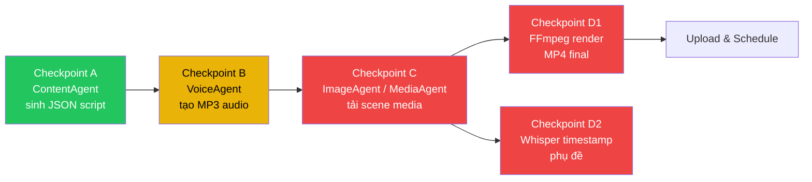

# 🔴 RÀ SOÁT KIẾN TRÚC — Devil's Advocate Review
## AI YouTube Automation MVP

> **Reviewer Role:** Senior Systems Architect — Phản biện khắt khe  
> **Scope:** Toàn bộ codebase tại [`AI-youtube-main/`](file:///e:/AI%20Youtube/AI-youtube-main)  
> **Phương pháp:** Đọc từng file source code, đối chiếu chéo giữa tài liệu (Whitepaper, Roadmap) và implementation thực tế.

---

## 1. 🔥 Mâu thuẫn ngầm giữa Data Contracts và FFmpeg Helper

### 1.1. SceneContract — KHÔNG TỒN TẠI dưới dạng code

Tài liệu Whitepaper mô tả pipeline:
> `ContentAgent → JSON scenes[] → ImageAgent/MediaAgent → FFmpeg Pan & Zoom`

**Nhưng trong code thực tế:**

| Lớp | Thực trạng | Vấn đề |
|---|---|---|
| [`content_agent.py`](file:///e:/AI%20Youtube/AI-youtube-main/app/agents/content_agent.py) | Trả về `Dict[str, Any]` từ `json.loads(response.text)` (dòng 69) | **Không validate schema.** Gemini trả gì thì nhận nấy. Không có Pydantic model, không có `SceneContract`. |
| [`image_agent.py`](file:///e:/AI%20Youtube/AI-youtube-main/app/agents/image_agent.py) | Nhận `prompt: str` đơn lẻ (dòng 21) | **Không hiểu khái niệm "scene".** Không nhận `scene_id`, `estimated_seconds`, `visual_keyword`. |
| [`media_agent.py`](file:///e:/AI%20Youtube/AI-youtube-main/app/agents/media_agent.py) | Nhận `query: str` (dòng 13) | Tương tự — không có khái niệm nối chuỗi scene. |
| [`ffmpeg_helper.py`](file:///e:/AI%20Youtube/AI-youtube-main/app/utils/ffmpeg_helper.py) | **Chỉ có 2 hàm:** `is_ffmpeg_installed()` và `get_ffmpeg_version()` | ⛔ **Hoàn toàn trống logic render.** Không có hàm nào nhận scene list, concatenate clips, hay tạo video output. |

> [!CAUTION]
> **Mâu thuẫn nghiêm trọng #1:** Tài liệu hứa pipeline `scenes[] → per-scene media → FFmpeg concat + subtitle + BGM → MP4 output`, nhưng code **chưa có bất kỳ cầu nối nào** giữa output của ContentAgent và input của FFmpeg. Không có `RenderJobContract` hay bất kỳ data class nào orchestrate luồng này.

### 1.2. RenderJobContract — Phantom Contract

Prompt trong [`content_agent.py`](file:///e:/AI%20Youtube/AI-youtube-main/app/agents/content_agent.py#L44-L58) yêu cầu Gemini trả JSON có cấu trúc:
```json
{
  "scenes": [{
    "scene_id": 1,
    "narration": "...",
    "visual_keyword": "dark aesthetic city street",
    "estimated_seconds": 4
  }]
}
```

**Nhưng không agent nào downstream consume cấu trúc này:**

- `ImageAgent.generate_scene_image()` — nhận `prompt: str` thô, không nhận object scene.
- `MediaAgent.search_videos()` — nhận `query: str`, không biết `estimated_seconds` → **không thể cắt clip đúng độ dài**.
- `ffmpeg_helper.py` — **hoàn toàn không có hàm render.**
- `VideoJob` trong DB — lưu `script` dạng `Text` blob, **không lưu structured scenes JSON**.

> [!WARNING]
> **Kết luận:** SceneContract và RenderJobContract hiện chỉ tồn tại trong prompt gửi cho Gemini. Không có validation, không có type-safe data flow. Nếu Gemini trả sai schema (thiếu field, sai type), toàn bộ pipeline downstream sẽ crash silently hoặc produce garbage.

### 1.3. Xung đột `estimated_seconds` vs thực tế

- `ContentAgent` yêu cầu Gemini ước lượng `estimated_seconds` cho mỗi scene.
- **Nhưng thời lượng thực của video phụ thuộc vào TTS** (giọng đọc tự nhiên nhanh chậm khác nhau).
- `VoiceAgent` tạo MP3 nhưng **không trả về duration** — không có hàm `get_audio_duration()`.
- → FFmpeg không có cơ sở để align scene duration với actual audio → **video sẽ lệch khẩu hình hoặc lệch nhạc nền.**

---

## 2. 🔥 Failure Matrix — Các trường hợp sập/treo bị bỏ sót

### 2.1. Ma trận lỗi hiện tại

Tôi đã rà soát toàn bộ error handling trong codebase:

| Component | Exception Handling | Đánh giá |
|---|---|---|
| [`ContentAgent.generate_script()`](file:///e:/AI%20Youtube/AI-youtube-main/app/agents/content_agent.py#L60-L79) | `except Exception as e` → rotate key → retry 3 lần → `raise RuntimeError` | ⚠️ Catch quá rộng, không phân biệt Rate Limit vs Network Error vs Invalid JSON |
| [`VoiceAgent.generate_speech()`](file:///e:/AI%20Youtube/AI-youtube-main/app/agents/voice_agent.py#L21-L23) | `asyncio.run()` — **KHÔNG CÓ try/except** | ⛔ Crash trực tiếp nếu Edge-TTS timeout hoặc network lỗi |
| [`MediaAgent.search_videos()`](file:///e:/AI%20Youtube/AI-youtube-main/app/agents/media_agent.py#L13-L27) | Trả `[]` nếu lỗi, **nhưng `download_file()` raise_for_status()** | ⚠️ 0 kết quả + downstream không check → crash khi ghép scene |
| [`MediaAgent.download_file()`](file:///e:/AI%20Youtube/AI-youtube-main/app/agents/media_agent.py#L29-L36) | `raise_for_status()` — **KHÔNG CÓ try/except** | ⛔ HTTP 403/500 → unhandled exception |
| [`ImageAgent.generate_scene_image()`](file:///e:/AI%20Youtube/AI-youtube-main/app/agents/image_agent.py#L21-L47) | Logic Imagen 3 **đang bị comment out** (dòng 44-45) | ⛔ Trả về `output_path` mà **file không tồn tại trên disk** → downstream crash |
| [`DriveAgent.upload_video()`](file:///e:/AI%20Youtube/AI-youtube-main/app/agents/drive_agent.py#L22-L40) | Trả mock data — **KHÔNG CÓ actual upload** | ⚠️ `delete_local_file()` sẽ xóa video gốc mà chưa upload thật |
| [`handlers.py` → `idea_command()`](file:///e:/AI%20Youtube/AI-youtube-main/app/bot/handlers.py#L149-L187) | `except Exception as e` → edit message | ⚠️ Không rollback VideoJob nếu lỗi giữa chừng |
| DB sessions | `db.close()` manual — **KHÔNG dùng context manager** | ⚠️ Connection leak nếu exception xảy ra trước `db.close()` |

### 2.2. 🚨 Trường hợp sập/treo CHƯA ĐƯỢC TÍNH ĐẾN

> [!CAUTION]
> Các failure mode nghiêm trọng dưới đây **hoàn toàn vắng mặt** trong cả tài liệu lẫn code:

#### F1: FFmpeg Zombie Process
- `ffmpeg_helper.py` gọi `subprocess.run()` nhưng **không set `timeout`**.
- Nếu FFmpeg treo (ví dụ: file media bị corrupt), process sẽ treo vô hạn → **block toàn bộ Telegram bot thread**.
- **Impact:** Bot ngừng phản hồi mọi lệnh từ nhóm chat.

#### F2: SQLite WAL Lock Under Concurrent Writes
- Tài liệu đề cập "SQLite + WAL" nhưng code tạo engine **KHÔNG bật WAL mode**:
  ```python
  # settings.py dòng 29
  DATABASE_URL = "sqlite:///./storage/ai_youtube.db"
  # models.py dòng 7
  engine = create_engine(settings.DATABASE_URL, echo=False)
  # → Không có: engine.execute("PRAGMA journal_mode=WAL")
  ```
- FastAPI (uvicorn, async) + Telegram bot (async) **đồng thời ghi DB** → risk `database is locked` error.
- `SessionLocal` không cấu hình `pool_size`, `pool_timeout` → SQLite default = 5 giây → timeout crash.

#### F3: asyncio.run() Inside Running Event Loop
- [`VoiceAgent.generate_speech()`](file:///e:/AI%20Youtube/AI-youtube-main/app/agents/voice_agent.py#L21-L23) gọi `asyncio.run()`.
- Nhưng Telegram bot **đã chạy trong async event loop** (python-telegram-bot v21+).
- → **`RuntimeError: This event loop is already running`** khi gọi VoiceAgent từ handler.
- Đây là bug chắc chắn xảy ra, không phải edge case.

#### F4: Gemini Invalid JSON — Silent Data Corruption
- [`content_agent.py` dòng 69](file:///e:/AI%20Youtube/AI-youtube-main/app/agents/content_agent.py#L69): `json.loads(response.text)` — nếu Gemini trả JSON có extra markdown fence (```json...```), sẽ crash.
- Dù có set `response_mime_type: application/json`, model vẫn có thể trả JSON thiếu field `scenes` hoặc `hook`.
- → `handlers.py` dòng 171 access `script_data.get("scenes", [])[:3]` → **silent empty data** thay vì báo lỗi → user thấy kịch bản "trống" mà không hiểu tại sao.

#### F5: Disk Space Exhaustion
- Pipeline tạo: MP3 audio + N scene images/videos + final MP4 → mỗi video ~50-200MB tạm.
- Batch 7 video/tuần → ~1.4GB temp files.
- `TEMP_DIR` / `OUTPUT_DIR` **KHÔNG có quota check, không có cleanup cron**.
- `DriveAgent.delete_local_file()` chỉ xóa 1 file, không xóa intermediate artifacts (audio, scene clips).
- → Laptop cá nhân (128-256GB SSD) sẽ đầy sau vài tuần nếu pipeline fail giữa chừng.

#### F6: Telegram Bot Callback Handlers — Missing Routes
- [`keyboards.py`](file:///e:/AI%20Youtube/AI-youtube-main/app/bot/keyboards.py#L13-L25) tạo nút: `publish_now:`, `schedule:`, `regenerate:`, `cancel:`.
- **Nhưng [`run.py`](file:///e:/AI%20Youtube/AI-youtube-main/run.py#L74) chỉ đăng ký handler cho `select_channel:`**.
- → User bấm "🚀 Đăng Ngay" hoặc "⏰ Lên Lịch" → **KHÔNG CÓ PHẢN HỒI** → UX chết.

#### F7: KeyRotator Infinite Cycle
- [`KeyRotator`](file:///e:/AI%20Youtube/AI-youtube-main/app/utils/key_rotator.py#L16) dùng `itertools.cycle()`.
- Nếu tất cả key đều bị rate-limited, `ContentAgent` retry 3 lần nhưng cycle **sẽ quay lại key đã fail** (nếu pool có 2 keys, retry 3 lần = key1 → key2 → key1 lại).
- Không có cooldown/backoff per-key → **sẽ spam rate-limited key liên tục**.

#### F8: `video_agent.py` — Phantom Module
- Tài liệu và README liệt kê [`video_agent.py`](file:///e:/AI%20Youtube/AI-youtube-main/app/agents/) trong `app/agents/`.
- **File này KHÔNG TỒN TẠI trong repository.** Agents directory chỉ có: `content_agent.py`, `voice_agent.py`, `media_agent.py`, `image_agent.py`, `drive_agent.py`, `publisher_agent.py`.
- → Toàn bộ Giai đoạn 3 (ghép video, phụ đề, BGM) **chưa có skeleton code**.

---

## 3. 🔥 Phân tích Trình tự Checkpoint Sprint 1

### 3.1. Checkpoint hiện tại (suy ra từ Roadmap + code)



### 3.2. Phân tích gap giữa các checkpoint

#### A → B: ⚠️ NGUY HIỂM — Đứt gãy data contract

| Yếu tố | Trạng thái | Rủi ro |
|---|---|---|
| ContentAgent output → VoiceAgent input | ContentAgent trả `full_narration` (string). VoiceAgent nhận `text` (string). | ✅ **Tương thích** — nhưng chỉ ở mức narration toàn bộ. |
| Per-scene narration → Per-scene audio | ContentAgent trả `scenes[].narration`. Nhưng **không ai tách từng scene thành từng file audio riêng.** | ⛔ **Không tương thích.** VoiceAgent chỉ tạo 1 file MP3 duy nhất cho toàn bộ narration. FFmpeg cần biết timestamp chia scene → **KHÔNG CÓ DỮ LIỆU NÀY.** |
| Audio duration feedback | VoiceAgent trả `output_path` (string). **Không trả duration.** | ⛔ Scene `estimated_seconds` từ Gemini sẽ bị vô nghĩa. |

#### B → C: ⛔ ĐỨNG GÃY HOÀN TOÀN

- VoiceAgent output: 1 file MP3.
- ImageAgent/MediaAgent input: cần `visual_keyword` per scene + duration per scene.
- **Không có orchestrator** nào đọc `scenes[]` từ ContentAgent, gọi VoiceAgent per-scene, rồi match với MediaAgent per-scene.
- `VideoJob` DB model lưu `script` dạng Text blob → **mất structured data giữa checkpoint A và C.**

#### C → D1/D2: ⛔ CODE KHÔNG TỒN TẠI

- `video_agent.py` — file chưa tạo.
- `ffmpeg_helper.py` — chỉ check version, không render.
- Whisper-timestamped — chưa có trong code, chỉ đề cập trong roadmap.
- Nhạc nền BGM — chưa có logic audio ducking.
- Phụ đề "nhảy từng từ" kiểu Hormozi — cần timestamp word-level, chưa có pipeline nào.

### 3.3. Verdict: An toàn để code chưa?

> [!CAUTION]
> **CHƯA AN TOÀN.** Trình tự checkpoint hiện tại có **2 điểm đứt gãy nghiêm trọng** (B→C và C→D) khiến bạn không thể code liên tục từ A đến D mà không phải refactor lại từ đầu:
> 
> 1. **Thiếu Orchestrator Layer** — Không có class nào điều phối luồng `ContentAgent → VoiceAgent → MediaAgent → FFmpeg → PublisherAgent`. Mỗi agent là island riêng lẻ.
> 2. **VideoJob DB model thiếu trường** — Không lưu `scenes_json`, `audio_duration`, `media_paths[]`, `subtitle_path`. Khi code đến D1, bạn phải ALTER TABLE → migration pain.
> 3. **Contract giữa agents không type-safe** — Tất cả đều dùng `Dict[str, Any]` hoặc `str`. Một agent thay đổi output shape → agent sau crash mà không biết.

---

## 4. 🔴 3 KHUYẾN CÁO KỸ THUẬT QUAN TRỌNG NHẤT

Dưới đây là 3 thứ **bắt buộc phải chốt trước commit đầu tiên**, xếp theo mức độ nghiêm trọng:

---

### 🥇 Khuyến cáo #1: Định nghĩa Data Contracts bằng Pydantic — BẮT BUỘC

**Tại sao:** Hiện tại toàn bộ data flow giữa agents dựa vào `Dict[str, Any]` — bất kỳ thay đổi nào từ Gemini output hay code refactor đều gây chain-crash silent. Đây là single point of failure lớn nhất.

**Phải làm ngay:**

```python
# contracts.py — TẠO FILE NÀY TRƯỚC KHI CODE BẤT KỲ THỨ GÌ KHÁC
from pydantic import BaseModel, Field
from typing import List, Optional
from enum import Enum

class JobStatus(str, Enum):
    DRAFT = "DRAFT"
    SCRIPT_READY = "SCRIPT_READY"
    AUDIO_READY = "AUDIO_READY"
    MEDIA_READY = "MEDIA_READY"
    RENDERING = "RENDERING"
    RENDERED = "RENDERED"
    UPLOADING = "UPLOADING"
    SCHEDULED = "SCHEDULED"
    PUBLISHED = "PUBLISHED"
    FAILED = "FAILED"

class SceneContract(BaseModel):
    scene_id: int
    narration: str
    visual_keyword: str
    estimated_seconds: float = Field(gt=0, le=15)
    # Populated downstream:
    audio_path: Optional[str] = None
    audio_duration_ms: Optional[int] = None
    media_path: Optional[str] = None
    media_type: Optional[str] = None  # "image" | "video"

class ScriptContract(BaseModel):
    title: str
    hook: str
    full_narration: str
    scenes: List[SceneContract] = Field(min_length=1)
    tags: List[str]
    description: str

class RenderJobContract(BaseModel):
    job_id: int
    script: ScriptContract
    audio_path: str           # full narration MP3
    audio_duration_ms: int
    scenes: List[SceneContract]  # enriched with media_path
    subtitle_path: Optional[str] = None
    bgm_path: Optional[str] = None
    output_path: str
    resolution: str = "1080x1920"  # 9:16
    fps: int = 30
```

Mọi agent downstream **phải nhận và trả contract**, không nhận `str` hay `Dict` thô.

---

### 🥈 Khuyến cáo #2: Sửa 3 bug chắc chắn crash trước khi test

**Bug 1 — `asyncio.run()` inside running loop:**
```python
# voice_agent.py — BUG CHẮC CHẮN CRASH
def generate_speech(self, text, output_path, voice=None):
    return asyncio.run(...)  # ⛔ RuntimeError trong python-telegram-bot v21+
```
**Fix:** Dùng `await` trực tiếp hoặc `asyncio.get_event_loop().run_in_executor()`.

**Bug 2 — DB session leak:**
```python
# handlers.py — TẤT CẢ CÁC HANDLER
db = SessionLocal()
# ... code có thể throw exception ...
db.close()  # ⛔ Không bao giờ chạy nếu exception xảy ra ở giữa
```
**Fix:** Dùng context manager hoặc `try/finally`.

**Bug 3 — SQLite không bật WAL:**
```python
# models.py — THÊM SAU create_engine
from sqlalchemy import event

@event.listens_for(engine, "connect")
def set_sqlite_pragma(dbapi_connection, connection_record):
    cursor = dbapi_connection.cursor()
    cursor.execute("PRAGMA journal_mode=WAL")
    cursor.execute("PRAGMA busy_timeout=5000")
    cursor.close()
```

---

### 🥉 Khuyến cáo #3: Tạo Pipeline Orchestrator trước khi code từng agent

**Tại sao:** Hiện mỗi agent là đảo riêng biệt. Không có ai "chỉ huy" luồng A→B→C→D. Nếu code từng agent rời rạc rồi ghép sau, bạn sẽ phải refactor interface của tất cả agent.

**Phải tạo skeleton này trước:**

```python
# pipeline.py — ORCHESTRATOR
class VideoPipeline:
    """Điều phối toàn bộ luồng sản xuất 1 video"""
    
    def __init__(self, job_id: int):
        self.job_id = job_id
        self.status = JobStatus.DRAFT
    
    async def execute(self) -> RenderJobContract:
        """
        A → B → C → D1 → D2, với checkpoint tại mỗi bước.
        Nếu fail ở bước nào, lưu trạng thái để resume.
        """
        try:
            # A: Script
            script = await self._step_script()
            self._checkpoint(JobStatus.SCRIPT_READY)
            
            # B: Audio
            audio_path, duration = await self._step_audio(script)
            self._checkpoint(JobStatus.AUDIO_READY)
            
            # C: Media per scene
            scenes = await self._step_media(script.scenes, duration)
            self._checkpoint(JobStatus.MEDIA_READY)
            
            # D: Render
            output = await self._step_render(scenes, audio_path)
            self._checkpoint(JobStatus.RENDERED)
            
            return output
            
        except Exception as e:
            self._checkpoint(JobStatus.FAILED, error=str(e))
            raise
```

Đặc biệt chú ý: `_checkpoint()` phải ghi trạng thái vào DB để khi crash giữa chừng, có thể resume từ checkpoint cuối cùng thay vì bắt đầu lại từ đầu.

---

## Tổng kết

| # | Phát hiện | Mức độ | Phải sửa trước khi code? |
|---|---|---|---|
| 1 | Data Contracts không tồn tại → silent failures | 🔴 Critical | ✅ BẮT BUỘC |
| 2 | `asyncio.run()` crash trong event loop | 🔴 Critical | ✅ BẮT BUỘC |
| 3 | DB session leak + SQLite chưa bật WAL | 🔴 Critical | ✅ BẮT BUỘC |
| 4 | `video_agent.py` phantom — chưa tồn tại | 🟡 High | ✅ Phải có skeleton |
| 5 | Callback buttons không có handler | 🟡 High | Sớm sửa |
| 6 | `ImageAgent` trả path file không tồn tại | 🟡 High | Sớm sửa |
| 7 | FFmpeg subprocess không có timeout | 🟠 Medium | Sprint 1 |
| 8 | KeyRotator không có per-key cooldown | 🟠 Medium | Sprint 1 |
| 9 | Disk space không có quota/cleanup | 🟠 Medium | Sprint 1 |
| 10 | `channels.yaml` duplicate data (2 cấu trúc) | 🟢 Low | Sprint 2 |

> [!IMPORTANT]
> **Đánh giá tổng thể:** Codebase hiện tại **chưa sẵn sàng để bắt tay vào Sprint 1 coding** theo trình tự checkpoint A→D. Cần dành **1-2 ngày** để:
> 1. Tạo `contracts.py` (Pydantic models)
> 2. Fix 3 bug critical
> 3. Tạo skeleton `pipeline.py` orchestrator
> 4. Mở rộng `VideoJob` DB schema (thêm `scenes_json`, `audio_duration_ms`)
> 
> Sau đó mới bắt đầu code logic render FFmpeg, subtitle, BGM an toàn.
