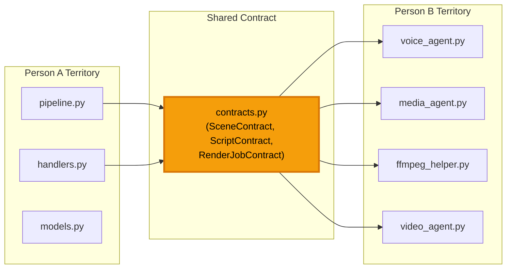

# 🏗️ BẢN KẾ HOẠCH TRIỂN KHAI CHI TIẾT
# AI YouTube Automation MVP — Actionable Implementation Plan

> **Team:** 2 người · **Scope:** 1 channel, Shorts, SQLite+WAL, Telegram UI, FFmpeg render  
> **Baseline:** Codebase tại [`AI-youtube-main/`](file:///e:/AI%20Youtube/AI-youtube-main)  
> **Tiền đề:** Đã chốt tất cả phát hiện từ Devil's Advocate Review

---

## 📁 CẤU TRÚC THƯ MỤC SAU KHI HOÀN THÀNH

```text
AI-youtube-main/
├── app/
│   ├── schemas/                    ← [NEW] Data Contracts
│   │   ├── __init__.py
│   │   └── contracts.py            ← Pydantic models (SceneContract, ScriptContract, RenderJobContract)
│   │
│   ├── services/                   ← [NEW] Business Logic Layer
│   │   ├── __init__.py
│   │   └── pipeline.py            ← VideoPipeline Orchestrator
│   │
│   ├── agents/
│   │   ├── content_agent.py       ← [MODIFY] Trả ScriptContract thay Dict
│   │   ├── voice_agent.py         ← [MODIFY] Fix async + per-scene audio
│   │   ├── media_agent.py         ← [MODIFY] Nhận SceneContract, trả enriched scene
│   │   ├── image_agent.py         ← (giữ nguyên, Phase 2)
│   │   ├── video_agent.py         ← [NEW] FFmpeg render engine
│   │   ├── drive_agent.py         ← (giữ nguyên, Phase 2)
│   │   └── publisher_agent.py     ← (giữ nguyên, Phase 2)
│   │
│   ├── bot/
│   │   ├── handlers.py            ← [MODIFY] Fix session leak + thêm callback handlers
│   │   └── keyboards.py           ← (giữ nguyên)
│   │
│   ├── database/
│   │   ├── __init__.py
│   │   └── models.py              ← [MODIFY] WAL pragma + VideoJob mở rộng
│   │
│   ├── utils/
│   │   ├── ffmpeg_helper.py       ← [MODIFY] Thêm render functions + timeout
│   │   └── key_rotator.py         ← (giữ nguyên)
│   │
│   └── web/
│       ├── server.py              ← (giữ nguyên)
│       └── static/
│
├── assets/
│   └── bgm/                       ← [NEW] Thư mục nhạc nền
│       └── default_bgm.mp3
│
├── storage/
│   ├── temp/                      ← Intermediate files (auto-cleanup)
│   │   └── job_{id}/              ← Mỗi job 1 thư mục riêng
│   └── outputs/                   ← Final MP4
│
└── tests/                          ← [NEW] Smoke tests
    ├── test_contracts.py
    └── test_pipeline_smoke.py
```

---

# 🔴 GIAI ĐOẠN 0: DẬP TẮT LỖI & DỰNG KHUNG XƯƠNG

> **Timeline:** Ngày 1 (bắt buộc hoàn thành trước khi code bất kỳ logic mới nào)  
> **Phụ trách:** Người A làm Commit 0.1 → 0.3, Người B làm Commit 0.4 **song song**

---

## Commit 0.1 — Tạo Data Contracts (Pydantic)

#### [NEW] [`app/schemas/__init__.py`](file:///e:/AI%20Youtube/AI-youtube-main/app/schemas/__init__.py)

```python
from app.schemas.contracts import (
    JobStatus,
    SceneContract,
    ScriptContract,
    RenderJobContract,
    AudioSegment,
)
```

#### [NEW] [`app/schemas/contracts.py`](file:///e:/AI%20Youtube/AI-youtube-main/app/schemas/contracts.py)

```python
"""
Data Contracts — Nguồn sự thật duy nhất cho toàn bộ data flow giữa các Agents.
Mọi agent PHẢI nhận/trả các model này, KHÔNG dùng Dict[str, Any] thô.
"""
import json
from enum import Enum
from typing import List, Optional
from pathlib import Path
from pydantic import BaseModel, Field, field_validator


class JobStatus(str, Enum):
    """Máy trạng thái (State Machine) của 1 VideoJob xuyên suốt pipeline."""
    DRAFT          = "DRAFT"
    SCRIPT_READY   = "SCRIPT_READY"
    AUDIO_READY    = "AUDIO_READY"
    MEDIA_READY    = "MEDIA_READY"
    RENDERING      = "RENDERING"
    RENDERED       = "RENDERED"
    UPLOADING      = "UPLOADING"
    SCHEDULED      = "SCHEDULED"
    PUBLISHED      = "PUBLISHED"
    FAILED         = "FAILED"


class SceneContract(BaseModel):
    """
    Đại diện cho 1 phân cảnh trong kịch bản.
    
    Luồng data enrichment:
      ContentAgent tạo → VoiceAgent bổ sung audio_* → MediaAgent bổ sung media_*
    """
    scene_id: int = Field(ge=1)
    narration: str = Field(min_length=1, description="Lời thoại của cảnh này")
    visual_keyword: str = Field(min_length=1, description="Từ khóa tìm media trên Pexels/Imagen")
    estimated_seconds: float = Field(gt=0, le=20, description="Ước lượng thô từ Gemini (tham khảo)")

    # --- Populated bởi VoiceAgent (Step B) ---
    audio_path: Optional[str] = Field(default=None, description="Đường dẫn file MP3 của riêng scene này")
    audio_duration_ms: Optional[int] = Field(default=None, ge=0, description="Thời lượng thực tế (ms) sau TTS")

    # --- Populated bởi MediaAgent/ImageAgent (Step C) ---
    media_path: Optional[str] = Field(default=None, description="Đường dẫn file ảnh/video nền cho scene")
    media_type: Optional[str] = Field(default=None, pattern=r"^(image|video)$")

    @field_validator("narration")
    @classmethod
    def narration_must_not_be_stage_direction(cls, v: str) -> str:
        """Bảo vệ: Gemini đôi khi trả stage direction thay vì lời thoại."""
        if v.strip().startswith("[") and v.strip().endswith("]"):
            raise ValueError(f"narration là stage direction, không phải lời thoại: {v}")
        return v.strip()

    @property
    def actual_duration_seconds(self) -> float:
        """Thời lượng THỰC TẾ dựa trên audio TTS. Fallback = estimated_seconds."""
        if self.audio_duration_ms is not None:
            return self.audio_duration_ms / 1000.0
        return self.estimated_seconds


class ScriptContract(BaseModel):
    """
    Output chuẩn của ContentAgent — kịch bản đã validate.
    Là nguồn sự thật cho title, hook, narration, SEO metadata.
    """
    title: str = Field(min_length=5, max_length=100)
    hook: str = Field(min_length=5, description="Câu hook 3 giây đầu")
    full_narration: str = Field(min_length=20, description="Toàn bộ lời thoại nối liền")
    scenes: List[SceneContract] = Field(min_length=1, max_length=15)
    tags: List[str] = Field(min_length=1, max_length=30)
    description: str = Field(min_length=10)

    @field_validator("scenes")
    @classmethod
    def scenes_must_have_sequential_ids(cls, v: List[SceneContract]) -> List[SceneContract]:
        """Đảm bảo scene_id liên tục 1, 2, 3, ..."""
        for i, scene in enumerate(v):
            if scene.scene_id != i + 1:
                raise ValueError(f"scene_id không liên tục: expected {i+1}, got {scene.scene_id}")
        return v

    @property
    def total_estimated_duration(self) -> float:
        return sum(s.estimated_seconds for s in self.scenes)

    def to_json_str(self) -> str:
        """Serialize để lưu vào cột scenes_json của VideoJob."""
        return self.model_dump_json()

    @classmethod
    def from_json_str(cls, json_str: str) -> "ScriptContract":
        """Deserialize từ cột scenes_json của VideoJob."""
        return cls.model_validate_json(json_str)


class AudioSegment(BaseModel):
    """Metadata của 1 file audio sau khi VoiceAgent tạo xong."""
    scene_id: int
    file_path: str
    duration_ms: int = Field(ge=0)
    voice_name: str


class RenderJobContract(BaseModel):
    """
    Input cho FFmpeg render pipeline.
    Chỉ được tạo SAU KHI tất cả scenes đã có audio_path và media_path.
    """
    job_id: int
    title: str
    scenes: List[SceneContract]
    
    # Paths
    full_audio_path: str = Field(description="MP3 concat toàn bộ narration")
    total_audio_duration_ms: int = Field(ge=0)
    subtitle_path: Optional[str] = Field(default=None, description="SRT file path")
    bgm_path: Optional[str] = Field(default=None, description="Background music MP3")
    output_path: str = Field(description="Đường dẫn MP4 đầu ra")

    # Render settings
    resolution_w: int = Field(default=1080)
    resolution_h: int = Field(default=1920)
    fps: int = Field(default=30)
    bgm_volume: float = Field(default=0.08, ge=0, le=1.0, description="Volume nhạc nền (0-1)")

    @field_validator("scenes")
    @classmethod
    def all_scenes_must_have_media(cls, v: List[SceneContract]) -> List[SceneContract]:
        """Gate-check: Không cho render nếu còn scene thiếu media."""
        for scene in v:
            if not scene.audio_path:
                raise ValueError(f"Scene {scene.scene_id} chưa có audio_path")
            if not scene.media_path:
                raise ValueError(f"Scene {scene.scene_id} chưa có media_path")
            if scene.audio_duration_ms is None:
                raise ValueError(f"Scene {scene.scene_id} chưa có audio_duration_ms")
        return v

    @property
    def resolution(self) -> str:
        return f"{self.resolution_w}x{self.resolution_h}"
```

> [!IMPORTANT]
> **Giải pháp Scene Timing:**  
> Chiến lược là **"Audio-First Timing"** — VoiceAgent sinh MP3 **per-scene** (không phải 1 file duy nhất). Thời lượng thực tế của mỗi scene = duration của MP3 tương ứng (đo bằng `ffprobe`). Field `estimated_seconds` từ Gemini chỉ dùng làm tham khảo ban đầu, KHÔNG dùng để quyết định render timeline. Chi tiết kỹ thuật ở Commit 0.4 bên dưới.

**Acceptance Criteria:**
- [ ] `from app.schemas.contracts import ScriptContract` chạy không lỗi
- [ ] `ScriptContract(**sample_dict)` validate thành công với data mẫu
- [ ] `ScriptContract(**bad_dict)` raise `ValidationError` khi thiếu field hoặc sai type

---

## Commit 0.2 — Fix SQLite WAL + Mở rộng VideoJob

#### [MODIFY] [`app/database/models.py`](file:///e:/AI%20Youtube/AI-youtube-main/app/database/models.py)

```python
from datetime import datetime
from sqlalchemy import create_engine, Column, Integer, String, Text, DateTime, ForeignKey, event
from sqlalchemy.orm import declarative_base, sessionmaker, relationship
from contextlib import contextmanager
from config.settings import settings

Base = declarative_base()
engine = create_engine(
    settings.DATABASE_URL,
    echo=False,
    connect_args={"check_same_thread": False},  # Bắt buộc cho SQLite + multi-thread
)

# ──────────────────────────────────────────────
# FIX CRITICAL: Bật WAL mode + busy_timeout
# ──────────────────────────────────────────────
@event.listens_for(engine, "connect")
def _set_sqlite_pragma(dbapi_connection, connection_record):
    cursor = dbapi_connection.cursor()
    cursor.execute("PRAGMA journal_mode=WAL")
    cursor.execute("PRAGMA busy_timeout=5000")   # chờ 5s thay vì crash ngay
    cursor.execute("PRAGMA synchronous=NORMAL")  # an toàn + nhanh hơn FULL
    cursor.close()

SessionLocal = sessionmaker(autocommit=False, autoflush=False, bind=engine)


# ──────────────────────────────────────────────
# FIX CRITICAL: Context manager chống session leak
# ──────────────────────────────────────────────
@contextmanager
def get_db():
    """
    Dùng: with get_db() as db:
    Tự động commit nếu thành công, rollback + close nếu exception.
    """
    db = SessionLocal()
    try:
        yield db
        db.commit()
    except Exception:
        db.rollback()
        raise
    finally:
        db.close()


class User(Base):
    __tablename__ = "users"

    telegram_id = Column(Integer, primary_key=True)
    username = Column(String(100), nullable=True)
    full_name = Column(String(150), nullable=True)
    role = Column(String(50), default="creator")
    active_channel_id = Column(String(100), nullable=True)
    created_at = Column(DateTime, default=datetime.utcnow)
    last_active = Column(DateTime, default=datetime.utcnow, onupdate=datetime.utcnow)

    jobs = relationship("VideoJob", back_populates="creator")
    activities = relationship("ActivityLog", back_populates="user")


class VideoJob(Base):
    __tablename__ = "video_jobs"

    id = Column(Integer, primary_key=True, autoincrement=True)
    user_id = Column(Integer, ForeignKey("users.telegram_id"))
    target_channel_id = Column(String(100), nullable=False)

    # Nội dung
    topic = Column(String(255), nullable=False)
    title = Column(String(255), nullable=True)
    script = Column(Text, nullable=True)          # full_narration text (backward compat)
    description = Column(Text, nullable=True)
    tags = Column(String(500), nullable=True)

    # ──────────────────────────────────────────
    # [NEW] Structured data — Giải quyết đứt gãy contract
    # ──────────────────────────────────────────
    scenes_json = Column(Text, nullable=True)      # ScriptContract.to_json_str()
    audio_duration_ms = Column(Integer, nullable=True)
    render_manifest = Column(Text, nullable=True)  # RenderJobContract JSON snapshot

    # Trạng thái — Mở rộng với thêm trạng thái trung gian
    status = Column(String(50), default="DRAFT")
    error_message = Column(Text, nullable=True)    # [NEW] Lưu traceback khi FAILED

    # Đường dẫn file & lưu trữ
    video_path = Column(String(500), nullable=True)
    audio_path = Column(String(500), nullable=True)
    subtitle_path = Column(String(500), nullable=True)  # [NEW]
    drive_link = Column(String(500), nullable=True)

    # YouTube info
    youtube_video_id = Column(String(100), nullable=True)
    scheduled_time = Column(DateTime, nullable=True)

    created_at = Column(DateTime, default=datetime.utcnow)
    updated_at = Column(DateTime, default=datetime.utcnow, onupdate=datetime.utcnow)

    creator = relationship("User", back_populates="jobs")


class ActivityLog(Base):
    __tablename__ = "activity_logs"

    id = Column(Integer, primary_key=True, autoincrement=True)
    telegram_id = Column(Integer, ForeignKey("users.telegram_id"), nullable=True)
    username = Column(String(100), nullable=True)
    action_type = Column(String(100), nullable=False)
    details = Column(Text, nullable=False)
    channel_id = Column(String(100), nullable=True)
    created_at = Column(DateTime, default=datetime.utcnow)

    user = relationship("User", back_populates="activities")


def log_activity(db, telegram_id: int, username: str, action_type: str, details: str, channel_id: str = None):
    """Hàm tiện ích ghi lại vết hành động của thành viên để theo dõi trên Web Dashboard"""
    try:
        activity = ActivityLog(
            telegram_id=telegram_id,
            username=username or f"User_{telegram_id}",
            action_type=action_type,
            details=details,
            channel_id=channel_id,
            created_at=datetime.utcnow()
        )
        db.add(activity)
        db.commit()
    except Exception as e:
        db.rollback()


def init_db():
    Base.metadata.create_all(bind=engine)
```

> [!WARNING]
> **Migration cho DB hiện có:** Nếu `ai_youtube.db` đã có dữ liệu, thêm cột mới bằng:
> ```sql
> ALTER TABLE video_jobs ADD COLUMN scenes_json TEXT;
> ALTER TABLE video_jobs ADD COLUMN audio_duration_ms INTEGER;
> ALTER TABLE video_jobs ADD COLUMN render_manifest TEXT;
> ALTER TABLE video_jobs ADD COLUMN error_message TEXT;
> ALTER TABLE video_jobs ADD COLUMN subtitle_path VARCHAR(500);
> ```
> Hoặc đơn giản **xóa file DB cũ** vì MVP chưa có data production.

**Acceptance Criteria:**
- [ ] `python -c "from app.database.models import get_db; print('OK')"` chạy không lỗi
- [ ] Mở DB bằng SQLite browser → chạy `PRAGMA journal_mode;` → output = `wal`
- [ ] `VideoJob` có đủ 5 cột mới: `scenes_json`, `audio_duration_ms`, `render_manifest`, `error_message`, `subtitle_path`

---

## Commit 0.3 — Fix Session Leak trong Handlers

#### [MODIFY] [`app/bot/handlers.py`](file:///e:/AI%20Youtube/AI-youtube-main/app/bot/handlers.py)

Thay thế **toàn bộ pattern** `db = SessionLocal() ... db.close()` bằng `with get_db() as db:`.

```python
import logging
from datetime import datetime
from telegram import Update
from telegram.ext import ContextTypes
from config.settings import settings
from app.bot.keyboards import get_channel_selection_keyboard, get_video_review_keyboard
from app.database.models import get_db, User, VideoJob, log_activity
from app.agents.content_agent import ContentAgent
from app.schemas.contracts import ScriptContract

logger = logging.getLogger(__name__)
content_agent = ContentAgent()


def is_authorized(update: Update) -> bool:
    """
    Kiểm tra quyền truy cập:
    - Nếu tin nhắn đến từ Nhóm Chat nằm trong ALLOWED_TELEGRAM_GROUPS: Cho phép tất cả thành viên trong nhóm.
    - Nếu tin nhắn riêng tư (Direct Message): Kiểm tra xem user_id có nằm trong ALLOWED_TELEGRAM_USERS không.
    """
    chat = update.effective_chat
    user = update.effective_user

    # 1. Kiểm tra nhóm chat
    allowed_groups = settings.get_allowed_group_ids()
    if chat and chat.type in ["group", "supergroup"]:
        if not allowed_groups:
            return True
        return chat.id in allowed_groups

    # 2. Kiểm tra user cá nhân
    allowed_users = settings.get_allowed_users()
    if not allowed_users:
        return True
    return user.id in allowed_users


async def start_command(update: Update, context: ContextTypes.DEFAULT_TYPE):
    """Xử lý lệnh /start"""
    if not is_authorized(update):
        await update.message.reply_text("⛔ Nhóm hoặc tài khoản này chưa được cấp quyền sử dụng bot.")
        return

    user = update.effective_user
    chat = update.effective_chat
    is_group = chat.type in ["group", "supergroup"]

    # FIX: Dùng context manager — không bao giờ leak session
    with get_db() as db:
        db_user = db.query(User).filter(User.telegram_id == user.id).first()
        if not db_user:
            role = settings.get_allowed_users().get(user.id, "creator")
            db_user = User(
                telegram_id=user.id,
                username=user.username,
                full_name=user.full_name,
                role=role,
                last_active=datetime.utcnow()
            )
            db.add(db_user)
        else:
            db_user.last_active = datetime.utcnow()
        # commit tự động bởi get_db()

        log_activity(db, user.id, user.username, "START_BOT",
                     f"Khởi động bot từ {chat.type} '{chat.title or user.first_name}'")

    scope_text = f"nhóm **{chat.title}**" if is_group else f"bạn **{user.first_name}**"

    welcome_text = (
        f"🎬 **AI YouTube Multi-Channel Studio đã sẵn sàng cho {scope_text}!**\n\n"
        f"👥 **Cơ chế làm việc nhóm & Web Dashboard:**\n"
        f"• Mọi thành viên cùng ra lệnh, kịch bản hiển thị công khai trong nhóm.\n"
        f"• Theo dõi toàn bộ hoạt động của admin qua Web Dashboard thời gian thực!\n\n"
        f"📌 **Các lệnh chính:**\n"
        f"• `/channels` - Xem và chuyển đổi kênh YouTube muốn sản xuất\n"
        f"• `/idea <chủ đề>` - Lên kịch bản AI, chia phân cảnh và từ khóa Pexels\n"
        f"• `/status` - Báo cáo số lượng video và trạng thái hệ thống\n\n"
        f"👉 Hãy gõ `/channels` để chọn kênh bắt đầu!"
    )
    await update.message.reply_text(welcome_text, parse_mode="Markdown")


async def channels_command(update: Update, context: ContextTypes.DEFAULT_TYPE):
    """Hiển thị danh sách kênh cho cả nhóm cùng chọn"""
    if not is_authorized(update):
        return

    reply_markup = get_channel_selection_keyboard()
    await update.message.reply_text(
        "📺 **Chọn kênh YouTube mục tiêu cho dự án tiếp theo:**",
        reply_markup=reply_markup,
        parse_mode="Markdown"
    )


async def channel_callback(update: Update, context: ContextTypes.DEFAULT_TYPE):
    """Xử lý khi một thành viên bấm nút chọn kênh"""
    query = update.callback_query
    await query.answer()

    data = query.data
    if data.startswith("select_channel:"):
        channel_id = data.split(":")[1]
        user = query.from_user

        with get_db() as db:
            db_user = db.query(User).filter(User.telegram_id == user.id).first()
            if db_user:
                db_user.active_channel_id = channel_id
                db_user.last_active = datetime.utcnow()

            log_activity(db, user.id, user.username, "CHANGE_CHANNEL",
                         f"Chuyển kênh làm việc sang '{channel_id}'", channel_id=channel_id)

        await query.message.reply_text(
            f"✅ **{user.first_name}** đã chọn kênh: **{channel_id}**\n"
            f"Bây giờ cả nhóm có thể gõ: `/idea <chủ đề>` để bắt đầu tạo video cho kênh này!",
            parse_mode="Markdown"
        )


async def idea_command(update: Update, context: ContextTypes.DEFAULT_TYPE):
    """Lệnh sinh kịch bản AI và gửi vào nhóm cho mọi người cùng duyệt"""
    if not is_authorized(update):
        return

    if not context.args:
        await update.message.reply_text(
            "💡 Cú pháp: `/idea <chủ đề video>`\nVí dụ: `/idea 3 bí ẩn dưới đáy biển sâu`",
            parse_mode="Markdown")
        return

    topic = " ".join(context.args)
    user = update.effective_user

    # Lấy kênh đang hoạt động
    with get_db() as db:
        db_user = db.query(User).filter(User.telegram_id == user.id).first()
        channel_id = db_user.active_channel_id if db_user and db_user.active_channel_id else "channel_psychology"
        if db_user:
            db_user.last_active = datetime.utcnow()

        log_activity(db, user.id, user.username, "CMD_IDEA",
                     f"Yêu cầu lên ý tưởng video: '{topic}'", channel_id=channel_id)

    status_msg = await update.message.reply_text(
        f"🤖 **{user.first_name}** vừa yêu cầu lên ý tưởng: *\"{topic}\"*\n"
        f"Đang kích hoạt Gemini AI (Key Rotation Pool) để tạo kịch bản cho kênh `{channel_id}`...",
        parse_mode="Markdown"
    )

    try:
        # ContentAgent trả ScriptContract (validated Pydantic model)
        script: ScriptContract = content_agent.generate_script(
            topic=topic, channel_niche="general", language="en"
        )

        # Lưu vào Database — dùng context manager
        with get_db() as db:
            job = VideoJob(
                user_id=user.id,
                target_channel_id=channel_id,
                topic=topic,
                title=script.title,
                script=script.full_narration,
                description=script.description,
                tags=",".join(script.tags),
                scenes_json=script.to_json_str(),   # [NEW] Lưu structured data
                status="SCRIPT_READY"
            )
            db.add(job)
            db.flush()  # Lấy job.id trước commit
            job_id = job.id

            log_activity(db, user.id, user.username, "SCRIPT_CREATED",
                         f"Kịch bản #{job_id} đã hoàn thành: '{script.title}'",
                         channel_id=channel_id)

        # Soạn nội dung thông báo cho nhóm
        scenes_preview = "\n".join([
            f"• Cảnh {s.scene_id}: {s.narration[:60]}... _(Tìm: {s.visual_keyword})_"
            for s in script.scenes[:3]
        ])

        reply_content = (
            f"🎬 **KỊCH BẢN ĐÃ HOÀN THÀNH (Task #{job_id})**\n\n"
            f"📌 **Tiêu đề đề xuất:** {script.title}\n"
            f"🔥 **Hook 3 giây đầu:** \"{script.hook}\"\n\n"
            f"📝 **Phân cảnh tiêu biểu:**\n{scenes_preview}\n\n"
            f"⏱️ **Ước lượng:** ~{script.total_estimated_duration:.0f}s | {len(script.scenes)} cảnh\n\n"
            f"🗣️ **Người tạo:** {user.first_name} | 📺 **Kênh:** `{channel_id}`\n\n"
            f"👉 Cả nhóm hãy góp ý hoặc bấm nút bên dưới để tiến hành sản xuất video!"
        )

        review_markup = get_video_review_keyboard(job_id)
        await status_msg.edit_text(reply_content, reply_markup=review_markup, parse_mode="Markdown")

    except Exception as e:
        logger.error(f"Lỗi khi tạo kịch bản: {e}", exc_info=True)
        await status_msg.edit_text(f"❌ Có lỗi xảy ra khi tạo kịch bản: `{e}`", parse_mode="Markdown")


async def video_callback(update: Update, context: ContextTypes.DEFAULT_TYPE):
    """
    [NEW] Xử lý khi thành viên bấm nút: Đăng Ngay / Lên Lịch / Tạo Lại / Hủy
    """
    query = update.callback_query
    await query.answer()
    data = query.data
    user = query.from_user

    if data.startswith("publish_now:"):
        job_id = int(data.split(":")[1])
        # TODO Phase 2: Gọi pipeline.execute() → PublisherAgent
        await query.message.reply_text(
            f"🚀 **{user.first_name}** yêu cầu đăng video #{job_id} ngay!\n"
            f"⏳ Đang xếp hàng vào pipeline render...",
            parse_mode="Markdown"
        )

    elif data.startswith("schedule:"):
        job_id = int(data.split(":")[1])
        await query.message.reply_text(
            f"⏰ **{user.first_name}** yêu cầu lên lịch video #{job_id}!\n"
            f"⏳ Chức năng đặt lịch sẽ hoạt động sau khi render xong.",
            parse_mode="Markdown"
        )

    elif data.startswith("regenerate:"):
        job_id = int(data.split(":")[1])
        with get_db() as db:
            job = db.query(VideoJob).filter(VideoJob.id == job_id).first()
            if job:
                job.status = "DRAFT"
                log_activity(db, user.id, user.username, "REGENERATE",
                             f"Yêu cầu tạo lại kịch bản #{job_id}")
        await query.message.reply_text(
            f"🔄 **{user.first_name}** yêu cầu tạo lại kịch bản #{job_id}.\n"
            f"Hãy gõ `/idea <chủ đề mới>` để tạo kịch bản thay thế.",
            parse_mode="Markdown"
        )

    elif data.startswith("cancel:"):
        job_id = int(data.split(":")[1])
        with get_db() as db:
            job = db.query(VideoJob).filter(VideoJob.id == job_id).first()
            if job:
                job.status = "FAILED"
                job.error_message = f"Hủy bởi {user.first_name}"
                log_activity(db, user.id, user.username, "CANCEL_JOB",
                             f"Đã hủy video #{job_id}")
        await query.message.reply_text(
            f"❌ **{user.first_name}** đã hủy video #{job_id}.",
            parse_mode="Markdown"
        )


async def status_command(update: Update, context: ContextTypes.DEFAULT_TYPE):
    """Báo cáo tổng hợp số lượng video và tài nguyên"""
    if not is_authorized(update):
        return

    with get_db() as db:
        total_jobs = db.query(VideoJob).count()
        ready_jobs = db.query(VideoJob).filter(VideoJob.status == "SCRIPT_READY").count()

    text = (
        f"📊 **BÁO CÁO NHÓM LÀM VIỆC (AI STUDIO)**\n\n"
        f"• Tổng số video trong hệ thống: `{total_jobs}`\n"
        f"• Kịch bản đang chờ duyệt/render: `{ready_jobs}`\n"
        f"• Kho Google Drive 2TB: Sẵn sàng 🟢\n"
        f"• Cụm Google Ultra Quota: Đang hoạt động 🟢\n"
        f"• Web Dashboard: Đang trực tuyến tại cổng `http://localhost:8000` 🌐"
    )
    await update.message.reply_text(text, parse_mode="Markdown")
```

#### [MODIFY] [`run.py`](file:///e:/AI%20Youtube/AI-youtube-main/run.py) — Đăng ký missing callback handlers

Thêm vào dòng 74 (sau dòng `CallbackQueryHandler(channel_callback)`):

```diff
 app.add_handler(CallbackQueryHandler(channel_callback, pattern=r"^select_channel:"))
+app.add_handler(CallbackQueryHandler(video_callback, pattern=r"^(publish_now|schedule|regenerate|cancel):"))
```

Và cập nhật import:
```diff
-from app.bot.handlers import start_command, channels_command, status_command, idea_command, channel_callback
+from app.bot.handlers import start_command, channels_command, status_command, idea_command, channel_callback, video_callback
```

**Acceptance Criteria:**
- [ ] Không còn pattern `db = SessionLocal()` nào trong `handlers.py`
- [ ] Tất cả handler dùng `with get_db() as db:`
- [ ] `video_callback` được đăng ký trong `run.py` cho 4 pattern: `publish_now`, `schedule`, `regenerate`, `cancel`

---

## Commit 0.4 — Fix VoiceAgent Async + Per-Scene Audio

#### [MODIFY] [`app/agents/voice_agent.py`](file:///e:/AI%20Youtube/AI-youtube-main/app/agents/voice_agent.py)

```python
import asyncio
import logging
import subprocess
import json
from pathlib import Path
from typing import List, Optional
import edge_tts
from config.settings import settings
from app.schemas.contracts import SceneContract, AudioSegment

logger = logging.getLogger(__name__)


class VoiceAgent:
    """
    Agent chịu trách nhiệm tạo giọng đọc AI từ văn bản bằng Edge-TTS.

    Chiến lược Audio-First Timing:
      1. Sinh MP3 cho TỪNG scene riêng biệt.
      2. Đo duration thực bằng ffprobe.
      3. Ghi audio_path + audio_duration_ms ngược lại vào SceneContract.
      4. Concat tất cả scene audio → 1 file full_narration.mp3 cho FFmpeg.
    """

    def __init__(self, default_voice: str = None):
        self.default_voice = default_voice or settings.DEFAULT_TTS_VOICE

    # ──────────────────────────────────────────
    # PUBLIC API — Gọi từ Pipeline Orchestrator
    # ──────────────────────────────────────────

    async def generate_per_scene_audio(
        self,
        scenes: List[SceneContract],
        output_dir: str,
        voice: str = None
    ) -> List[SceneContract]:
        """
        Sinh MP3 cho từng scene. Trả về list SceneContract đã enriched
        với audio_path và audio_duration_ms.
        """
        selected_voice = voice or self.default_voice
        enriched_scenes = []

        for scene in scenes:
            scene_audio_path = str(Path(output_dir) / f"scene_{scene.scene_id:03d}.mp3")

            # Sinh audio cho 1 scene
            communicate = edge_tts.Communicate(scene.narration, selected_voice)
            await communicate.save(scene_audio_path)

            # Đo duration thực bằng ffprobe
            duration_ms = self._get_audio_duration_ms(scene_audio_path)

            # Enriched scene với actual timing
            enriched = scene.model_copy(update={
                "audio_path": scene_audio_path,
                "audio_duration_ms": duration_ms,
            })
            enriched_scenes.append(enriched)

            logger.info(
                f"Scene {scene.scene_id}: audio={duration_ms}ms "
                f"(estimated={scene.estimated_seconds}s, actual={duration_ms/1000:.1f}s)"
            )

        return enriched_scenes

    async def concat_scene_audio(
        self,
        scenes: List[SceneContract],
        output_path: str
    ) -> int:
        """
        Ghép tất cả scene audio thành 1 file MP3 liên tục.
        Trả về total_duration_ms.
        """
        # Tạo file list cho ffmpeg concat
        list_file = str(Path(output_path).parent / "audio_concat_list.txt")
        with open(list_file, "w", encoding="utf-8") as f:
            for scene in scenes:
                if not scene.audio_path:
                    raise ValueError(f"Scene {scene.scene_id} chưa có audio_path")
                # Escape single quotes trong path
                safe_path = scene.audio_path.replace("'", "'\\''")
                f.write(f"file '{safe_path}'\n")

        # FFmpeg concat demuxer
        cmd = [
            "ffmpeg", "-y",
            "-f", "concat",
            "-safe", "0",
            "-i", list_file,
            "-c", "copy",
            output_path
        ]
        proc = subprocess.run(cmd, capture_output=True, text=True, timeout=60)
        if proc.returncode != 0:
            raise RuntimeError(f"FFmpeg concat audio failed: {proc.stderr}")

        total_ms = self._get_audio_duration_ms(output_path)
        logger.info(f"Full narration audio: {total_ms}ms ({total_ms/1000:.1f}s)")
        return total_ms

    async def generate_full_narration(
        self,
        text: str,
        output_path: str,
        voice: str = None
    ) -> str:
        """
        Backward-compatible: Tạo 1 file audio từ toàn bộ narration.
        Dùng cho trường hợp không cần per-scene timing.
        """
        selected_voice = voice or self.default_voice
        communicate = edge_tts.Communicate(text, selected_voice)
        await communicate.save(output_path)
        return output_path

    # ──────────────────────────────────────────
    # PRIVATE HELPERS
    # ──────────────────────────────────────────

    @staticmethod
    def _get_audio_duration_ms(file_path: str) -> int:
        """Đo chính xác duration bằng ffprobe (ms). Fallback = 0."""
        try:
            cmd = [
                "ffprobe",
                "-v", "quiet",
                "-show_entries", "format=duration",
                "-of", "json",
                file_path
            ]
            result = subprocess.run(cmd, capture_output=True, text=True, timeout=10)
            data = json.loads(result.stdout)
            duration_sec = float(data["format"]["duration"])
            return int(duration_sec * 1000)
        except Exception as e:
            logger.warning(f"Không thể đo duration cho {file_path}: {e}")
            return 0
```

> [!IMPORTANT]
> **Giải pháp Scene Timing chi tiết:**
> 
> | Bước | Hành động | Kết quả |
> |---|---|---|
> | 1 | `generate_per_scene_audio()` sinh MP3 **per-scene** | Mỗi scene có file riêng: `scene_001.mp3`, `scene_002.mp3`, ... |
> | 2 | `ffprobe` đo duration thực | `scene.audio_duration_ms = 4200` (thay vì `estimated_seconds = 4`) |
> | 3 | `scene.actual_duration_seconds` property | FFmpeg dùng giá trị này để cắt/kéo media clip |
> | 4 | `concat_scene_audio()` ghép thành `full_narration.mp3` | 1 file audio duy nhất cho final render |
> 
> **Tại sao không dùng Edge-TTS boundary?** Edge-TTS có `WordBoundary` event nhưng nó trả offset theo byte/character, không phải timestamp chính xác. Per-scene audio + ffprobe cho kết quả chính xác 100%.

**Acceptance Criteria:**
- [ ] `VoiceAgent` không còn `asyncio.run()` — tất cả method là `async def`
- [ ] `generate_per_scene_audio()` trả `List[SceneContract]` với `audio_path` và `audio_duration_ms` populated
- [ ] `_get_audio_duration_ms()` trả duration chính xác (±50ms) so với file thực tế
- [ ] Có thể `await voice_agent.generate_per_scene_audio(scenes, dir)` từ trong Telegram handler

---

#### [MODIFY] [`app/agents/content_agent.py`](file:///e:/AI%20Youtube/AI-youtube-main/app/agents/content_agent.py) — Trả ScriptContract

Thay đổi dòng 29 và 69:

```diff
-    def generate_script(self, topic: str, channel_niche: str = "general", language: str = "en", max_retries: int = 3) -> Dict[str, Any]:
+    def generate_script(self, topic: str, channel_niche: str = "general", language: str = "en", max_retries: int = 3) -> "ScriptContract":
```

```diff
-                return json.loads(response.text)
+                raw = json.loads(response.text)
+                return ScriptContract(**raw)  # Validate qua Pydantic
```

Thêm import ở đầu file:
```diff
+from app.schemas.contracts import ScriptContract
```

**Acceptance Criteria:**
- [ ] `content_agent.generate_script()` trả `ScriptContract` (không phải `Dict`)
- [ ] Nếu Gemini trả JSON thiếu field → raise `ValidationError` rõ ràng (thay vì silent empty data)

---

# 🟢 GIAI ĐOẠN 1: ORCHESTRATOR & RENDER ENGINE

> **Timeline:** Ngày 2-5  
> **Phụ trách:** Người A → pipeline.py, Người B → ffmpeg_helper.py + video_agent.py

---

## Commit 1.1 — Pipeline Orchestrator Skeleton

#### [NEW] [`app/services/__init__.py`](file:///e:/AI%20Youtube/AI-youtube-main/app/services/__init__.py)

```python
from app.services.pipeline import VideoPipeline
```

#### [NEW] [`app/services/pipeline.py`](file:///e:/AI%20Youtube/AI-youtube-main/app/services/pipeline.py)

```python
"""
VideoPipeline — Orchestrator trung tâm điều phối luồng sản xuất video.

Luồng chính:
  A (Script) → B (Per-Scene Audio) → C (Per-Scene Media) → D (FFmpeg Render + QA)

Mỗi bước ghi checkpoint vào DB. Nếu crash → resume từ checkpoint cuối.
"""
import logging
import shutil
from pathlib import Path
from typing import Optional

from app.schemas.contracts import (
    JobStatus, ScriptContract, SceneContract, RenderJobContract
)
from app.database.models import get_db, VideoJob
from app.agents.content_agent import ContentAgent
from app.agents.voice_agent import VoiceAgent
from app.agents.media_agent import MediaAgent
from config.settings import settings

logger = logging.getLogger(__name__)


class VideoPipeline:
    """
    Orchestrator cho 1 VideoJob.

    Usage:
        pipeline = VideoPipeline(job_id=42)
        result = await pipeline.execute()
    """

    def __init__(self, job_id: int):
        self.job_id = job_id
        self.work_dir: Optional[Path] = None

        # Agents (lazy init)
        self._voice_agent = VoiceAgent()
        self._media_agent = MediaAgent()

    # ──────────────────────────────────────────
    # MAIN ENTRY POINT
    # ──────────────────────────────────────────

    async def execute(self) -> RenderJobContract:
        """
        Chạy toàn bộ pipeline A → B → C → D.
        Trả về RenderJobContract nếu thành công.
        Raise exception + set status FAILED nếu thất bại.
        """
        try:
            # Tạo thư mục làm việc riêng cho job
            self.work_dir = Path(settings.TEMP_DIR) / f"job_{self.job_id}"
            self.work_dir.mkdir(parents=True, exist_ok=True)

            # ── Step A: Load script từ DB ──
            script = self._load_script_from_db()
            logger.info(f"[Job {self.job_id}] Step A: Script loaded — {len(script.scenes)} scenes")

            # ── Step B: Generate per-scene audio ──
            self._update_status(JobStatus.AUDIO_READY, "Đang tạo giọng đọc...")
            enriched_scenes = await self._step_audio(script)
            full_audio_path, total_duration = await self._step_concat_audio(enriched_scenes)
            self._save_audio_metadata(full_audio_path, total_duration, enriched_scenes)
            logger.info(f"[Job {self.job_id}] Step B: Audio done — {total_duration}ms total")

            # ── Step C: Fetch per-scene media ──
            self._update_status(JobStatus.MEDIA_READY, "Đang tải media cho từng cảnh...")
            media_scenes = await self._step_media(enriched_scenes)
            logger.info(f"[Job {self.job_id}] Step C: Media done — {len(media_scenes)} scenes")

            # ── Step D: Render final MP4 ──
            self._update_status(JobStatus.RENDERING, "Đang render video...")
            output_path = str(Path(settings.OUTPUT_DIR) / f"video_{self.job_id}.mp4")

            render_job = RenderJobContract(
                job_id=self.job_id,
                title=script.title,
                scenes=media_scenes,
                full_audio_path=full_audio_path,
                total_audio_duration_ms=total_duration,
                bgm_path=self._find_bgm(),
                output_path=output_path,
            )

            # TODO: Gọi VideoAgent.render(render_job) ở Commit 1.2
            # await self._step_render(render_job)

            # ── Step D QA: Validate output bằng ffprobe ──
            # TODO: self._step_qa(output_path)

            self._update_status(JobStatus.RENDERED)
            self._save_render_manifest(render_job)
            logger.info(f"[Job {self.job_id}] Pipeline complete → {output_path}")
            return render_job

        except Exception as e:
            logger.error(f"[Job {self.job_id}] Pipeline FAILED: {e}", exc_info=True)
            self._update_status(JobStatus.FAILED, error_msg=str(e))
            raise

    # ──────────────────────────────────────────
    # STEP IMPLEMENTATIONS
    # ──────────────────────────────────────────

    def _load_script_from_db(self) -> ScriptContract:
        """Step A: Đọc scenes_json từ VideoJob, parse thành ScriptContract."""
        with get_db() as db:
            job = db.query(VideoJob).filter(VideoJob.id == self.job_id).first()
            if not job:
                raise ValueError(f"VideoJob #{self.job_id} không tồn tại")
            if not job.scenes_json:
                raise ValueError(f"VideoJob #{self.job_id} chưa có scenes_json (status={job.status})")
            return ScriptContract.from_json_str(job.scenes_json)

    async def _step_audio(self, script: ScriptContract) -> list[SceneContract]:
        """Step B: Sinh MP3 per-scene, enrich SceneContract với audio_path + duration."""
        audio_dir = str(self.work_dir / "audio")
        Path(audio_dir).mkdir(exist_ok=True)

        # Lấy voice từ channel config (nếu có)
        voice = self._get_channel_voice()

        return await self._voice_agent.generate_per_scene_audio(
            scenes=script.scenes,
            output_dir=audio_dir,
            voice=voice,
        )

    async def _step_concat_audio(self, scenes: list[SceneContract]) -> tuple[str, int]:
        """Ghép tất cả scene audio → 1 file full_narration.mp3."""
        full_audio_path = str(self.work_dir / "full_narration.mp3")
        total_ms = await self._voice_agent.concat_scene_audio(scenes, full_audio_path)
        return full_audio_path, total_ms

    async def _step_media(self, scenes: list[SceneContract]) -> list[SceneContract]:
        """Step C: Tải video/ảnh nền Pexels cho từng scene."""
        media_dir = str(self.work_dir / "media")
        Path(media_dir).mkdir(exist_ok=True)

        result = []
        for scene in scenes:
            media_path = await self._fetch_scene_media(scene, media_dir)
            enriched = scene.model_copy(update={
                "media_path": media_path,
                "media_type": "video" if media_path.endswith(".mp4") else "image",
            })
            result.append(enriched)
        return result

    async def _fetch_scene_media(self, scene: SceneContract, media_dir: str) -> str:
        """Tải 1 video Pexels phù hợp cho 1 scene."""
        videos = self._media_agent.search_videos(scene.visual_keyword, per_page=1)

        if videos:
            # Lấy video file có chất lượng cao nhất dạng portrait
            video_data = videos[0]
            video_files = video_data.get("video_files", [])
            # Ưu tiên HD portrait
            best = next(
                (f for f in video_files if f.get("height", 0) >= 1080 and f.get("width", 0) <= f.get("height", 0)),
                video_files[0] if video_files else None
            )
            if best:
                output = str(Path(media_dir) / f"scene_{scene.scene_id:03d}.mp4")
                self._media_agent.download_file(best["link"], output)
                return output

        # Fallback: placeholder image (sẽ dùng Ken Burns effect)
        logger.warning(f"Scene {scene.scene_id}: Không tìm thấy video Pexels cho '{scene.visual_keyword}'")
        placeholder = str(Path(media_dir) / f"scene_{scene.scene_id:03d}_placeholder.png")
        self._create_placeholder_image(placeholder, scene.visual_keyword)
        return placeholder

    # ──────────────────────────────────────────
    # DB CHECKPOINT HELPERS
    # ──────────────────────────────────────────

    def _update_status(self, status: JobStatus, error_msg: str = None):
        """Ghi checkpoint trạng thái vào DB — resume-safe."""
        with get_db() as db:
            job = db.query(VideoJob).filter(VideoJob.id == self.job_id).first()
            if job:
                job.status = status.value
                if error_msg:
                    job.error_message = error_msg

    def _save_audio_metadata(self, audio_path: str, duration_ms: int, scenes: list[SceneContract]):
        """Lưu metadata audio vào DB sau Step B."""
        with get_db() as db:
            job = db.query(VideoJob).filter(VideoJob.id == self.job_id).first()
            if job:
                job.audio_path = audio_path
                job.audio_duration_ms = duration_ms
                # Cập nhật scenes_json với audio enrichment
                # Rebuild ScriptContract từ DB rồi cập nhật scenes
                if job.scenes_json:
                    script = ScriptContract.from_json_str(job.scenes_json)
                    updated_script = script.model_copy(update={"scenes": scenes})
                    job.scenes_json = updated_script.to_json_str()

    def _save_render_manifest(self, render_job: RenderJobContract):
        """Lưu render manifest snapshot vào DB."""
        with get_db() as db:
            job = db.query(VideoJob).filter(VideoJob.id == self.job_id).first()
            if job:
                job.render_manifest = render_job.model_dump_json()
                job.video_path = render_job.output_path

    # ──────────────────────────────────────────
    # UTILITY HELPERS
    # ──────────────────────────────────────────

    def _get_channel_voice(self) -> Optional[str]:
        """Tra cứu preferred_voice từ channels.yaml dựa trên target_channel_id."""
        with get_db() as db:
            job = db.query(VideoJob).filter(VideoJob.id == self.job_id).first()
            if not job:
                return None
            channels = settings.get_channels_config()
            for ch in channels:
                if ch.get("id") == job.target_channel_id:
                    return ch.get("preferred_voice")
        return None

    def _find_bgm(self) -> Optional[str]:
        """Tìm file nhạc nền mặc định."""
        bgm_path = Path(settings.BASE_DIR) / "assets" / "bgm" / "default_bgm.mp3"
        return str(bgm_path) if bgm_path.exists() else None

    @staticmethod
    def _create_placeholder_image(path: str, text: str):
        """Tạo ảnh placeholder 1080x1920 khi không tìm được media."""
        try:
            from PIL import Image, ImageDraw, ImageFont
            img = Image.new("RGB", (1080, 1920), color=(20, 20, 30))
            draw = ImageDraw.Draw(img)
            # Vẽ text ở giữa
            draw.text((540, 960), text[:40], fill=(100, 100, 120), anchor="mm")
            img.save(path)
        except ImportError:
            # Nếu không có Pillow, tạo file trống
            Path(path).touch()

    def cleanup_temp(self):
        """Xóa thư mục tạm sau khi pipeline hoàn tất."""
        if self.work_dir and self.work_dir.exists():
            shutil.rmtree(self.work_dir, ignore_errors=True)
            logger.info(f"[Job {self.job_id}] Đã dọn dẹp temp: {self.work_dir}")
```

**Acceptance Criteria:**
- [ ] `from app.services.pipeline import VideoPipeline` chạy không lỗi
- [ ] `VideoPipeline(job_id=1)` khởi tạo thành công
- [ ] Pipeline ghi đúng status vào DB tại mỗi checkpoint: `SCRIPT_READY → AUDIO_READY → MEDIA_READY → RENDERING → RENDERED`
- [ ] Nếu crash ở Step C, DB lưu `status=FAILED` + `error_message`

---

## Commit 1.2 — FFmpeg Render Engine (4 Checkpoints)

#### [MODIFY] [`app/utils/ffmpeg_helper.py`](file:///e:/AI%20Youtube/AI-youtube-main/app/utils/ffmpeg_helper.py)

```python
"""
FFmpeg Helper — Các hàm thao tác FFmpeg cấp thấp với timeout an toàn.
Mọi subprocess.run() đều có timeout để tránh zombie process.
"""
import shutil
import subprocess
import json
import logging
from pathlib import Path
from typing import Optional, Dict

logger = logging.getLogger(__name__)

FFMPEG_TIMEOUT = 300   # 5 phút max cho render
FFPROBE_TIMEOUT = 10   # 10 giây max cho probe


def is_ffmpeg_installed() -> bool:
    """Kiểm tra xem ffmpeg đã có trong PATH hệ thống hay chưa"""
    return shutil.which("ffmpeg") is not None


def get_ffmpeg_version() -> str:
    """Lấy thông tin phiên bản ffmpeg nếu có"""
    if not is_ffmpeg_installed():
        return "Not installed"
    try:
        res = subprocess.run(
            ["ffmpeg", "-version"],
            stdout=subprocess.PIPE, stderr=subprocess.PIPE,
            text=True, timeout=FFPROBE_TIMEOUT
        )
        return res.stdout.split("\n")[0]
    except Exception as e:
        return f"Error: {e}"


def probe_file(file_path: str) -> Optional[Dict]:
    """
    Chạy ffprobe và trả về metadata JSON đầy đủ.
    Trả None nếu lỗi.
    """
    try:
        cmd = [
            "ffprobe", "-v", "quiet",
            "-print_format", "json",
            "-show_format", "-show_streams",
            file_path
        ]
        result = subprocess.run(cmd, capture_output=True, text=True, timeout=FFPROBE_TIMEOUT)
        if result.returncode == 0:
            return json.loads(result.stdout)
    except Exception as e:
        logger.warning(f"ffprobe failed for {file_path}: {e}")
    return None


def get_duration_ms(file_path: str) -> int:
    """Lấy duration (ms) của file audio/video. Trả 0 nếu lỗi."""
    info = probe_file(file_path)
    if info and "format" in info:
        try:
            return int(float(info["format"]["duration"]) * 1000)
        except (KeyError, ValueError):
            pass
    return 0


def run_ffmpeg(args: list[str], timeout: int = FFMPEG_TIMEOUT) -> subprocess.CompletedProcess:
    """
    Wrapper an toàn cho ffmpeg subprocess.
    - Luôn có timeout
    - Raise RuntimeError nếu returncode != 0
    """
    cmd = ["ffmpeg", "-y"] + args
    logger.info(f"FFmpeg command: {' '.join(cmd)}")

    result = subprocess.run(
        cmd,
        capture_output=True,
        text=True,
        timeout=timeout
    )

    if result.returncode != 0:
        raise RuntimeError(
            f"FFmpeg failed (code={result.returncode}):\n"
            f"stderr: {result.stderr[-500:]}"  # Chỉ lấy 500 ký tự cuối
        )

    return result


def image_to_video(
    image_path: str,
    duration_seconds: float,
    output_path: str,
    width: int = 1080,
    height: int = 1920,
    fps: int = 30,
    zoom_effect: bool = True,
) -> str:
    """
    CHECKPOINT A: Biến 1 ảnh tĩnh → video MP4 với Ken Burns (pan & zoom) effect.
    """
    if zoom_effect:
        # Ken Burns: Slow zoom in từ 1.0x → 1.15x
        zoompan = (
            f"zoompan=z='min(zoom+0.0005,1.15)':"
            f"x='iw/2-(iw/zoom/2)':y='ih/2-(ih/zoom/2)':"
            f"d={int(duration_seconds * fps)}:s={width}x{height}:fps={fps}"
        )
    else:
        zoompan = f"scale={width}:{height}:force_original_aspect_ratio=decrease,pad={width}:{height}:(ow-iw)/2:(oh-ih)/2"

    args = [
        "-loop", "1",
        "-i", image_path,
        "-vf", zoompan,
        "-t", str(duration_seconds),
        "-c:v", "libx264",
        "-pix_fmt", "yuv420p",
        "-r", str(fps),
        output_path
    ]
    run_ffmpeg(args)
    return output_path


def trim_video(
    input_path: str,
    duration_seconds: float,
    output_path: str,
    width: int = 1080,
    height: int = 1920,
) -> str:
    """
    Cắt video Pexels về đúng duration cần thiết + scale 9:16.
    """
    args = [
        "-i", input_path,
        "-t", str(duration_seconds),
        "-vf", f"scale={width}:{height}:force_original_aspect_ratio=increase,crop={width}:{height}",
        "-c:v", "libx264",
        "-c:a", "aac",
        "-an",  # Bỏ audio gốc của stock video
        output_path
    ]
    run_ffmpeg(args)
    return output_path


def concat_videos(
    video_paths: list[str],
    output_path: str,
) -> str:
    """
    CHECKPOINT B: Ghép N video clips thành 1 file liên tục.
    """
    list_file = str(Path(output_path).parent / "video_concat_list.txt")
    with open(list_file, "w", encoding="utf-8") as f:
        for vp in video_paths:
            safe = vp.replace("'", "'\\''")
            f.write(f"file '{safe}'\n")

    args = [
        "-f", "concat",
        "-safe", "0",
        "-i", list_file,
        "-c", "copy",
        output_path
    ]
    run_ffmpeg(args)
    return output_path


def mux_audio_video(
    video_path: str,
    audio_path: str,
    output_path: str,
    bgm_path: str = None,
    bgm_volume: float = 0.08,
) -> str:
    """
    CHECKPOINT C: Ghép audio narration + video + optional BGM.
    Audio ducking: BGM giảm volume khi có narration.
    """
    if bgm_path and Path(bgm_path).exists():
        # Complex filter: mix narration (loud) + BGM (quiet)
        args = [
            "-i", video_path,
            "-i", audio_path,
            "-i", bgm_path,
            "-filter_complex",
            f"[2:a]volume={bgm_volume},aloop=loop=-1:size=2e+09[bgm];"
            f"[1:a][bgm]amix=inputs=2:duration=first:dropout_transition=2[aout]",
            "-map", "0:v",
            "-map", "[aout]",
            "-c:v", "copy",
            "-c:a", "aac",
            "-b:a", "192k",
            "-shortest",
            output_path
        ]
    else:
        args = [
            "-i", video_path,
            "-i", audio_path,
            "-map", "0:v",
            "-map", "1:a",
            "-c:v", "copy",
            "-c:a", "aac",
            "-b:a", "192k",
            "-shortest",
            output_path
        ]

    run_ffmpeg(args)
    return output_path


def burn_subtitles(
    video_path: str,
    srt_path: str,
    output_path: str,
    font_size: int = 24,
    font_color: str = "&HFFFFFF",
    outline_color: str = "&H000000",
    bold: bool = True,
) -> str:
    """
    CHECKPOINT C (part 2): Burn-in subtitle SRT vào video (hardcode).
    """
    style = (
        f"FontSize={font_size},"
        f"PrimaryColour={font_color},"
        f"OutlineColour={outline_color},"
        f"Bold={'1' if bold else '0'},"
        f"Alignment=2,"      # Bottom center
        f"MarginV=60"        # Margin từ đáy
    )
    # Escape path cho Windows
    srt_escaped = srt_path.replace("\\", "/").replace(":", "\\:")

    args = [
        "-i", video_path,
        "-vf", f"subtitles='{srt_escaped}':force_style='{style}'",
        "-c:v", "libx264",
        "-c:a", "copy",
        output_path
    ]
    run_ffmpeg(args, timeout=FFMPEG_TIMEOUT * 2)  # Subtitle burn chậm hơn
    return output_path


def validate_output(file_path: str) -> Dict:
    """
    CHECKPOINT D: QA tự động — Kiểm tra file output bằng ffprobe.
    Trả dict kết quả kiểm tra.
    """
    info = probe_file(file_path)
    result = {
        "valid": False,
        "file_exists": Path(file_path).exists(),
        "file_size_mb": 0,
        "duration_ms": 0,
        "has_video": False,
        "has_audio": False,
        "resolution": "",
        "codec_video": "",
        "codec_audio": "",
        "errors": [],
    }

    if not result["file_exists"]:
        result["errors"].append("File không tồn tại")
        return result

    result["file_size_mb"] = round(Path(file_path).stat().st_size / (1024 * 1024), 2)

    if not info:
        result["errors"].append("ffprobe không đọc được file")
        return result

    result["duration_ms"] = get_duration_ms(file_path)

    for stream in info.get("streams", []):
        if stream.get("codec_type") == "video":
            result["has_video"] = True
            result["resolution"] = f"{stream.get('width')}x{stream.get('height')}"
            result["codec_video"] = stream.get("codec_name", "unknown")
        elif stream.get("codec_type") == "audio":
            result["has_audio"] = True
            result["codec_audio"] = stream.get("codec_name", "unknown")

    # Validation rules cho YouTube Shorts
    if not result["has_video"]:
        result["errors"].append("Không có video stream")
    if not result["has_audio"]:
        result["errors"].append("Không có audio stream")
    if result["duration_ms"] < 5000:
        result["errors"].append(f"Video quá ngắn: {result['duration_ms']}ms (tối thiểu 5s)")
    if result["duration_ms"] > 61000:
        result["errors"].append(f"Video quá dài cho Shorts: {result['duration_ms']}ms (tối đa 60s)")
    if result["file_size_mb"] < 0.1:
        result["errors"].append(f"File quá nhỏ: {result['file_size_mb']}MB — có thể bị corrupt")

    result["valid"] = len(result["errors"]) == 0
    return result
```

**Acceptance Criteria:**
- [ ] `run_ffmpeg()` luôn có timeout (không zombie process)
- [ ] `image_to_video()` tạo được MP4 từ 1 ảnh + duration — **Checkpoint A pass**
- [ ] `concat_videos()` ghép N clips — **Checkpoint B pass**
- [ ] `mux_audio_video()` ghép voice + optional BGM — **Checkpoint C pass**
- [ ] `validate_output()` trả `{"valid": True}` cho file MP4 hợp lệ — **Checkpoint D pass**

---

# 👥 PHÂN CHIA QUYỀN SỞ HỮU CODE (CODE OWNERSHIP)

> [!IMPORTANT]
> **Quy tắc vàng:** Mỗi file chỉ có **1 người sở hữu chính**. Nếu cần sửa file của người kia, tạo Pull Request và tag review. KHÔNG commit trực tiếp vào No-Edit Zone của người khác.

## Bảng phân chia

```
┌──────────────────────────────────────────────────────────────────────┐
│                        PERSON A (Logic & UI)                        │
│  Ownership: Contracts, Database, Pipeline, Bot handlers, Web API    │
├──────────────────────────────────────────────────────────────────────┤
│  ✅ OWN (chỉ A commit trực tiếp):                                  │
│    app/schemas/contracts.py                                         │
│    app/schemas/__init__.py                                          │
│    app/database/models.py                                           │
│    app/services/pipeline.py                                         │
│    app/services/__init__.py                                         │
│    app/bot/handlers.py                                              │
│    app/bot/keyboards.py                                             │
│    app/web/server.py                                                │
│    app/web/static/*                                                 │
│    run.py                                                           │
│    config/settings.py                                               │
│    config/channels.yaml                                             │
├──────────────────────────────────────────────────────────────────────┤
│  🔒 NO-EDIT ZONE (không sửa trực tiếp):                            │
│    app/agents/voice_agent.py                                        │
│    app/agents/media_agent.py                                        │
│    app/agents/video_agent.py       ← B tạo mới                     │
│    app/utils/ffmpeg_helper.py                                       │
│    app/agents/publisher_agent.py                                    │
└──────────────────────────────────────────────────────────────────────┘

┌──────────────────────────────────────────────────────────────────────┐
│                   PERSON B (Production & Engine)                    │
│  Ownership: FFmpeg, Voice, Media, Video render, YouTube publisher   │
├──────────────────────────────────────────────────────────────────────┤
│  ✅ OWN (chỉ B commit trực tiếp):                                  │
│    app/agents/voice_agent.py                                        │
│    app/agents/media_agent.py                                        │
│    app/agents/video_agent.py       ← TẠO MỚI                       │
│    app/agents/image_agent.py                                        │
│    app/agents/drive_agent.py                                        │
│    app/agents/publisher_agent.py                                    │
│    app/utils/ffmpeg_helper.py                                       │
│    assets/*                                                         │
│    tests/*                                                          │
├──────────────────────────────────────────────────────────────────────┤
│  🔒 NO-EDIT ZONE (không sửa trực tiếp):                            │
│    app/schemas/*                                                    │
│    app/database/*                                                   │
│    app/services/*                                                   │
│    app/bot/*                                                        │
│    app/web/*                                                        │
│    run.py                                                           │
└──────────────────────────────────────────────────────────────────────┘

┌──────────────────────────────────────────────────────────────────────┐
│                    SHARED (cả 2 đều được sửa)                       │
├──────────────────────────────────────────────────────────────────────┤
│    README.md                                                        │
│    ROADMAP.md                                                       │
│    requirements.txt                                                 │
│    .env.example                                                     │
│    .gitignore                                                       │
│    app/agents/__init__.py                                           │
│    app/utils/__init__.py                                            │
└──────────────────────────────────────────────────────────────────────┘
```

## Giao diện hợp đồng giữa A và B

Hai người **chỉ giao tiếp qua interface** của `contracts.py`:



> **Nguyên tắc:** Nếu cần thay đổi shape của SceneContract (thêm/đổi field), **cả A và B phải đồng ý** trước khi commit. File `contracts.py` là "hiến pháp" của dự án.

---

# ✅ CHECKLIST TRIỂN KHAI THEO TỪNG COMMIT

## Giai đoạn 0 — Ngày 1

| Commit | Người | File | Việc cần làm | Acceptance Criteria |
|--------|-------|------|-------------|---------------------|
| **0.1** | A | `app/schemas/contracts.py` | Tạo file Pydantic contracts | `ScriptContract(**sample)` validate OK; `ScriptContract(**bad)` raise ValidationError |
| **0.2** | A | `app/database/models.py` | Thêm WAL pragma, `get_db()` context manager, mở rộng VideoJob | `PRAGMA journal_mode;` → `wal`; VideoJob có 5 cột mới |
| **0.3** | A | `app/bot/handlers.py` + `run.py` | Fix session leak, thêm `video_callback`, đăng ký handler | Không còn `SessionLocal()` trực tiếp; 4 callback pattern hoạt động |
| **0.4** | B | `app/agents/voice_agent.py` | Fix async, thêm per-scene audio + ffprobe duration | Không còn `asyncio.run()`; `generate_per_scene_audio()` trả scenes có `audio_duration_ms` |
| **0.4b** | B | `app/agents/content_agent.py` | Thay return Dict → ScriptContract | `generate_script()` trả `ScriptContract`; Gemini JSON thiếu field → ValidationError |

**Verification Ngày 1:**
```bash
# Chạy toàn bộ import chain
python -c "
from app.schemas.contracts import ScriptContract, RenderJobContract, JobStatus
from app.database.models import get_db, VideoJob
from app.agents.content_agent import ContentAgent
from app.agents.voice_agent import VoiceAgent
from app.services.pipeline import VideoPipeline
print('✅ All imports OK')
"
```

---

## Giai đoạn 1 — Ngày 2-5

| Commit | Người | File | Việc cần làm | Acceptance Criteria |
|--------|-------|------|-------------|---------------------|
| **1.1** | A | `app/services/pipeline.py` | Tạo VideoPipeline orchestrator skeleton | Pipeline ghi checkpoint đúng vào DB; crash → FAILED + error_message |
| **1.2** | B | `app/utils/ffmpeg_helper.py` | Thêm render functions: `image_to_video`, `trim_video`, `concat_videos`, `mux_audio_video`, `burn_subtitles`, `validate_output` | Mỗi hàm có timeout; Checkpoint A,B,C,D pass |
| **1.3** | B | `app/agents/video_agent.py` [NEW] | Tạo VideoAgent gọi ffmpeg_helper theo RenderJobContract | `VideoAgent.render(render_job)` → file MP4 valid |
| **1.4** | A | `app/services/pipeline.py` | Tích hợp VideoAgent vào Step D | `pipeline.execute()` chạy end-to-end: Script → Audio → Media → Render → QA |
| **1.5** | A | `app/bot/handlers.py` | Wire `publish_now` callback → `pipeline.execute()` | User bấm "🚀 Đăng Ngay" → pipeline chạy background → bot report kết quả |

**Verification Ngày 5 (Smoke Test):**
```bash
# Test end-to-end: Tạo 1 video từ script có sẵn
python -c "
import asyncio
from app.services.pipeline import VideoPipeline

async def test():
    p = VideoPipeline(job_id=1)  # Job phải tồn tại trong DB với status=SCRIPT_READY
    result = await p.execute()
    print(f'Output: {result.output_path}')
    print(f'Duration: {result.total_audio_duration_ms}ms')

asyncio.run(test())
"
```

**Kiểm tra output:**
```bash
ffprobe -v quiet -print_format json -show_format -show_streams storage/outputs/video_1.mp4
# Expected: has_video=true, has_audio=true, duration=30-60s, codec=h264+aac, resolution=1080x1920
```

---

## Git Workflow

```bash
# Mỗi commit tuân thủ format:
git commit -m "fix(database): enable WAL mode + add get_db() context manager"
git commit -m "feat(schemas): add Pydantic data contracts"
git commit -m "fix(voice): replace asyncio.run with native async"
git commit -m "feat(pipeline): add VideoPipeline orchestrator skeleton"
git commit -m "feat(ffmpeg): add render functions with timeout safety"

# Branch strategy:
# main ← không commit trực tiếp
# develop ← merge từ feature branches
# feature/phase0-contracts ← Person A
# feature/phase0-voice-fix ← Person B
```

---

> [!CAUTION]
> **Điều kiện tiên quyết TRƯỚC khi bắt đầu Giai đoạn 1:**
> 1. ✅ Tất cả 5 commit Giai đoạn 0 đã merge vào `develop`
> 2. ✅ `python -c "from app.schemas.contracts import *; from app.database.models import get_db"` chạy OK
> 3. ✅ File DB cũ đã xóa hoặc migrate xong
> 4. ✅ FFmpeg đã cài và `ffmpeg -version` + `ffprobe -version` đều trả output
