# 🚀 KẾ HOẠCH NÂNG CẤP TOÀN DIỆN HỆ THỐNG: TẠO VIDEO YOUTUBE SHORTS VIRAL TỰ ĐỘNG
> **Dự án:** AI YouTube Multi-Channel Studio  
> **Mục tiêu:** Nâng cấp toàn diện các agent từ Topic, Script, Audio, Visuals đến Subtitle & Publishing để sản xuất video tự động có chất lượng và tỷ lệ giữ chân (Retention) ngang ngửa hoặc vượt kịch bản thủ công triệu view.  
> **Thời gian lập:** 03/10/2026  

---

## 📑 MỤC LỤC
1. [Bản đồ hiện trạng & Điểm nghẽn hệ thống (Gap Analysis)](#1-bản-đồ-hiện-trạng--điểm-nghẽn-hệ-thống-gap-analysis)
2. [Trụ cột 1: Ý tưởng & Tiêu đề Phá vỡ Định kiến (Viral Topic & Hook Engine)](#2-trụ-cột-1-ý-tưởng--tiêu-đề-phá-vỡ-định-kiến-viral-topic--hook-engine)
3. [Trụ cột 2: Kịch nghệ Giữ Chân 35-45s & Vòng lặp Vô tận (Retention Scriptwriting)](#3-trụ-cột-2-kịch-nghệ-giữ-chân-35-45s--vòng-lặp-vô-tận-retention-scriptwriting)
4. [Trụ cột 3: Đồng bộ Hệ thống Thẩm định & Bộ lọc Chất lượng (Quality Gates)](#4-trụ-cột-3-đồng-bộ-hệ-thống-thẩm-định--bộ-lọc-chất-lượng-quality-gates)
5. [Trụ cột 4: Thiết kế Âm thanh Điện ảnh & Hiệu ứng SFX (Cinematic Sound Design)](#5-trụ-cột-4-thiết-kế-âm-thanh-điện-ảnh--hiệu-ứng-sfx-cinematic-sound-design)
6. [Trụ cột 5: Dựng Phim Động, Phụ Đề Nảy Chữ & Xử Lý Song Song (Visuals & Motion FX)](#6-trụ-cột-5-dựng-phim-động-phụ-đề-nảy-chữ--xử-lý-song-song-visuals--motion-fx)
7. [Trụ cột 6: Phân phối Thuật toán & Bình luận Ghim Tương tác (Algorithm Distribution)](#7-trụ-cột-6-phân-phối-thuật-toán--bình-luận-ghim-tương-tác-algorithm-distribution)
8. [Lộ trình triển khai (Sprint Roadmap)](#8-lộ-trình-triển-khai-sprint-roadmap)

---

## 1. BẢN ĐỒ HIỆN TRẠNG & ĐIỂM NGHẼN HỆ THỐNG (GAP ANALYSIS)

```mermaid
graph TD
    A[HỆ THỐNG HIỆN TẠI] --> B[Topic: LLM sinh chung chung]
    A --> C[Script: Ép cứng 20-28s, câu cuối đòi CTA]
    A --> D[Critic & Linter: Bị lệch pha, trừ điểm kịch bản >32s]
    A --> E[Audio: TTS đều đều, thiếu SFX giật gân]
    A --> F[Visual: Sinh tuần tự 6-10 phút, dễ timeout]
    A --> G[Publish: Đăng video nhưng chưa có comment mồi tương tác]

    H[HỆ THỐNG SAU NÂNG CẤP VIRAL] --> I[Topic: Outlier Trend Hunter + Shock Angle]
    H --> J[Script: 35-45s, 3-Second Hook Trap + Seamless Loop]
    H --> K[Critic & Linter: Chuẩn hóa 35-45s, Viral Predictor >= 8.5]
    H --> L[Audio: Dynamic Pacing 165 WPM + SFX Risers & Drops]
    H --> M[Visual: Sinh song song 90s + Kinetic Glowing Subtitles]
    H --> N[Publish: Chọn Frame Sốc + Tự ghim Comment tranh luận]
```

---

## 2. TRỤ CỘT 1: Ý TƯỞNG & TIÊU ĐỀ PHÁ VỠ ĐỊNH KIẾN (VIRAL TOPIC & HOOK ENGINE)

### 🚨 Điểm nghẽn hiện tại:
- [`app/services/channel_intelligence.py`](file:///d:/AI_YouTube_Project_Ready/AI-youtube-main/app/services/channel_intelligence.py): Ý tưởng được sinh từ prompt mô tả chung chung về ngách (ví dụ: *"loài rắn độc nhất"*, *"vết cắn của rắn lục"*), thiếu yếu tố giật gân (Curiosity Gap).
- Tiêu đề mang tính mô tả tĩnh, chưa đánh vào nỗi sợ hãi nguyên thủy (Primal Fear) hoặc sự tò mò không cưỡng lại được.

### ⚡ Nâng cấp:
1. **Module `OutlierTrendHunter`:**
   - Quét các video viral trong ngách trên YouTube/Reddit/TikTok có tỷ lệ `View / Subs > 5x` trong 7 ngày gần nhất.
2. **Kỹ nghệ Tạo Góc Nhìn (Shock Angle Transformation):**
   - Biến một sự thật sinh học bình thường thành một câu chuyện kịch tính:
     * *Chủ đề gốc:* Rắn Pit Viper cắn con mồi.
     * *Angle Viral:* "Một giọt nọc làm tan chảy thịt trước khi não kịp nhận tín hiệu đau."
3. **Tiêu đề theo công thức Curiosity Gap (5 biến thể bắt buộc):**
   - Công thức A: `[Hành động cấm đoán] + [Hậu quả rùng rợn]` ("Never Look Into Its Eyes ⚠️")
   - Công thức B: `[Con số giật gân] + [Cơ chế sinh học]` ("One Drop Melts Flesh at 1,000 FPS ☠️")

---

## 3. TRỤ CỘT 2: KỊCH NGHỆ GIỮ CHÂN 35-45s & VÒNG LẶP VÔ TẬN (RETENTION SCRIPTWRITING)

### 🚨 Điểm nghẽn hiện tại:
- [`app/agents/content_agent.py:438-460`](file:///d:/AI_YouTube_Project_Ready/AI-youtube-main/app/agents/content_agent.py#L438-L460): Ép cứng thời lượng `20 - 28 SECONDS (50 to 75 words)`.
- Cảnh cuối ép model phải nhét câu CTA như *"Drop your thoughts below / Comment below"*, phá vỡ hoàn toàn vòng lặp vô tận (Infinite Loop).

### ⚡ Nâng cấp:
1. **Nâng chuẩn thời lượng vàng lên 35 - 45 giây (80 - 115 từ):**
   - Cho phép kịch bản có đủ không gian xây dựng cao trào (Buildup -> Climax -> Twist).
2. **Bộ 3 Công thức Hook 3 Giây Bất Bại (Scene 1):**
   - *Cảnh báo khẩn cấp (Urgent Danger):* "If you see these dead leaves twitch, you are already dead..."
   - *Cắt đứt nhận thức (Pattern Interrupt):* "Your skin doesn't bleed when this strikes. It liquefies..."
   - *Bí mật che giấu (Unsolved Secret):* "Scientists recorded this at 1,000 frames per second, and what they found is terrifying..."
3. **Triệt tiêu CTA sáo rỗng — Thay thế bằng "Seamless Loop Bridge":**
   - Câu kết phải là một nửa vế câu mở để khi phát lại, video tự động tiếp nối vào Scene 1:
     * *Scene cuối kết:* `"And that is the horrifying truth about why..."`
     * *Scene 1 mở đầu:* `"One single drop melts your flesh before pain hits!"`

---

## 4. TRỤ CỘT 3: ĐỒNG BỘ HỆ THỐNG THẨM ĐỊNH & BỘ LỌC CHẤT LƯỢNG (QUALITY GATES)

### 🚨 Điểm nghẽn hiện tại:
- [`app/services/content_linter.py:144`](file:///d:/AI_YouTube_Project_Ready/AI-youtube-main/app/services/content_linter.py#L144): Báo lỗi nếu kịch bản > 85 từ.
- [`app/graph/evaluators/script_critic.py:80`](file:///d:/AI_YouTube_Project_Ready/AI-youtube-main/app/graph/evaluators/script_critic.py#L80): Chấm điểm khắt khe, trừ điểm kịch bản nếu > 28s.
- Trong khi [`app/graph/evaluators/audio_qa.py:55`](file:///d:/AI_YouTube_Project_Ready/AI-youtube-main/app/graph/evaluators/audio_qa.py#L55) lại khuyến nghị thời lượng `>= 35s`.

### ⚡ Nâng cấp:
1. **Thống nhất chuẩn thời lượng 32s - 50s xuyên suốt toàn bộ codebase:**
   - `ContentLinter`: Cho phép 75 - 120 từ (tương ứng 32s - 48s tại 150-165 WPM).
   - `ScriptCritic`: Chấm điểm Pacing dựa trên nhịp cảnh (2.5 - 4s/cảnh) thay vì ép tổng độ dài dưới 28s.
2. **Bộ dự đoán Viral (Viral Potential Predictor >= 8.5):**
   - Đo lường chỉ số **VVSA Score (Viewed vs Swiped Away)** mô phỏng: Nếu câu Hook chưa đạt 8.5, kích hoạt vòng lặp viết lại riêng Scene 1 tối đa 3 lần.

---

## 5. TRỤ CỘT 4: THIẾT KẾ ÂM THANH ĐIỆN ẢNH & HIỆU ỨNG SFX (CINEMATIC SOUND DESIGN)

### 🚨 Điểm nghẽn hiện tại:
- Giọng đọc Edge-TTS chạy đều đều ở tốc độ 1.0x, chưa có điểm nhấn kịch tính.
- Hiệu ứng âm thanh SFX (Whoosh, Riser, Boom, Heartbeat) chỉ mới có trong công cụ thủ công, pipeline tự động chưa chèn SFX vào các mốc then chốt.

### ⚡ Nâng cấp:
1. **Tốc độ đọc linh hoạt (Pacing 160 - 170 WPM):**
   - Đẩy tốc độ đọc của TTS lên `+10%` đến `+15%` để tạo nhịp điệu dồn dập, hồi hộp.
2. **Auto SFX Sync (Đồng bộ hiệu ứng âm thanh tự động theo kịch bản):**
   - **Giây 0.0s (Cảnh 1):** Tự động lồng tiếng hiệu ứng chớp/va đập mạnh (`cinematic_hit.mp3` hoặc `bass_drop.mp3`) để thu hút thính giác ngay lập tức.
   - **Chuyển cảnh (Scene Cuts):** Tự động lồng tiếng `whoosh_fast.mp3` mỗi khi đổi cảnh.
   - **Đoạn cao trào (Climax):** Tự động chèn tiếng `heartbeat_rising.mp3` hoặc `riser_tension.mp3`.
3. **Smart Audio Ducking:**
   - Tự động hạ âm lượng nhạc nền xuống -18dB khi có giọng đọc và đẩy lên -10dB ở các khoảng lặng 0.3s giữa các cảnh.

---

## 6. TRỤ CỘT 5: DỰNG PHIM ĐỘNG, PHỤ ĐỀ NẢY CHỮ & XỬ LÝ SONG SONG (VISUALS & MOTION FX)

### 🚨 Điểm nghẽn hiện tại:
- Sinh media tuần tự từng cảnh: 6 cảnh x 1 phút = 6 phút; nếu AI Vision chê 4 cảnh thì vẽ lại thêm 4 phút -> Chạm ngưỡng timeout 10 phút.
- Phụ đề karaoke hiện tại hiển thị tốt nhưng chưa có animation nảy chữ mạnh mẽ kiểu Shorts viral hiện đại (MrBeast / Hormozi style).

### ⚡ Nâng cấp:
1. **Xử lý Song song (Parallel Generation với `asyncio.gather`):**
   - Sinh đồng thời tất cả 6 cảnh ảnh/video thay vì tuần tự từng cảnh một.
   - Rút ngắn thời gian sinh toàn bộ tài nguyên từ **6 - 9 phút xuống còn 60 - 90 giây**!
   - Nâng timeout render trong `server.py` từ **10 phút lên 20 phút** để dự phòng an toàn tuyệt đối.
2. **Kinetic Bouncing Subtitles (Phụ đề nảy chữ bắt mắt):**
   - Sử dụng font chữ đậm nét (The Bold Font / Montserrat Black).
   - Từ đang nói được phóng to nhẹ (Scale 1.15) và đổi sang màu vàng chanh (`#FFEE00`) hoặc đỏ lửa (`#FF3333`) với viền đen dày (`border 3px`).
   - Giữ mắt người xem luôn tập trung vào giữa màn hình, tăng APV thêm 20-30%.
3. **Hiệu ứng Chuyển động Đa chiều (Dynamic Camera Moves):**
   - Luân phiên đổi kiểu chuyển động mỗi cảnh: Zoom In -> Zoom Out -> Pan Trái -> Pan Phải -> Whip Pan để triệt tiêu cảm giác nhàm chán.

---

## 7. TRỤ CỘT 6: PHÂN PHỐI THUẬT TOÁN & BÌNH LUẬN GHIM TƯƠNG TÁC (ALGORITHM DISTRIBUTION)

### 🚨 Điểm nghẽn hiện tại:
- Video đăng lên YouTube theo lịch nhưng thiếu cơ chế "kích nổ" tương tác ban đầu trong 30 phút đầu tiên.

### ⚡ Nâng cấp:
1. **Thumbnail Best-Frame Selector:**
   - Tự động quét 3 khung hình có độ tương phản cao nhất và chi tiết gây sốc nhất ở Cảnh 1 để đặt làm Thumbnail Shorts.
2. **Auto Pinned Question Comment (Mồi bình luận tự động):**
   - Ngay sau khi upload thành công, bot tự động dùng chính kênh YouTube đăng 1 bình luận ghim (Pinned Comment) đặt câu hỏi kích thích tranh luận:
     * *Ví dụ:* *"Nếu bị loài này cắn ở ngón tay, bạn có dám tự chặt ngón tay để cứu mạng không? 👇"*
   - Bình luận này sẽ kích thích người xem dừng lại gõ comment tranh cãi -> YouTube ghi nhận lượng tương tác khủng và đẩy video vào Wave 2/Wave 3.
3. **Hashtag & Tag Matrix chuẩn hóa:**
   - 3 hashtag chính trong mô tả: `#shorts #chủ_đề_ngách #viral`.

---

## 8. LỘ TRÌNH TRIỂN KHAI (SPRINT ROADMAP)

| Giai đoạn | Nội dung nâng cấp trọng tâm | Thời gian dự kiến | Mục tiêu đầu ra |
|---|---|:---:|---|
| **Sprint 1: Phá bỏ Rào cản Kỹ thuật** | - Tăng timeout render lên 20 phút - Đồng bộ thời lượng 35-45s trong Linter & Critic - Mở song song hóa `asyncio.gather` sinh media | 1 - 2 ngày | Pipeline chạy mượt mà dưới 3 phút, không bao giờ bị timeout |
| **Sprint 2: Kịch nghệ & Hook Viral** | - Cập nhật prompt ContentAgent (3-second hook trap + seamless loop) - Tinh chỉnh ScriptCritic loại bỏ CTA sáo rỗng | 2 - 3 ngày | Kịch bản tự động đạt điểm Critic >= 8.5/10 với vòng lặp hoàn hảo |
| **Sprint 3: Âm thanh & Hình ảnh Đỉnh cao** | - Nâng cấp phụ đề Kinetic Bouncing Subtitles - Tự động chèn SFX Whoosh/Boom vào các mốc cảnh - Tối ưu nhịp đọc TTS 165 WPM | 3 - 4 ngày | Video sinh động, nhịp điệu dồn dập, chuẩn điện ảnh Shorts |
| **Sprint 4: Thuật toán & Tương tác Tự động** | - Module tự động chọn Frame sốc làm thumbnail - Tự động đăng bình luận ghim mồi tương tác | 2 ngày | Tăng tỷ lệ VVSA > 80% và kích nổ tương tác ban đầu |

---
*Tài liệu này được phê duyệt làm kim chỉ nam để đưa chất lượng video tự động của AI YouTube Studio lên chuẩn triệu view.*
