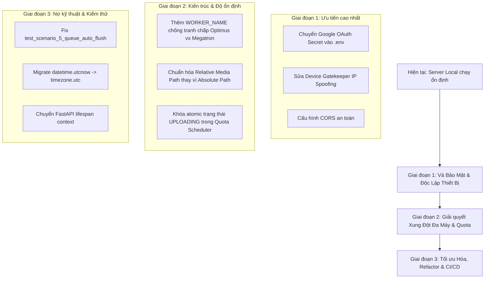

# 📋 KẾ HOẠCH SỬA LỖI, VÁ LỖ HỔNG BẢO MẬT & NÂNG CẤP HỆ THỐNG
> **Dự án:** AI YouTube Multi-Channel Studio  
> **Trạng thái máy chủ:** Đang chạy Local ổn định (`http://localhost:8000`, bot Megatron Telegram hoạt động)  
> **Ngày lập kế hoạch:** 03/10/2026  
> **Mục đích:** Tài liệu hóa toàn bộ các lỗ hổng tiềm ẩn, xung đột kiến trúc đa máy (Optimus vs Megatron), lỗi hàng chờ quota và nợ kỹ thuật để lên lộ trình xử lý an toàn theo từng giai đoạn, không làm gián đoạn quá trình vận hành hiện tại.

---

## 📑 MỤC LỤC
1. [Tổng quan & Ma trận phân loại rủi ro](#1-tổng-quan--ma-trận-phân-loại-rủi-ro)
2. [Chi tiết các lỗ hổng & Sai sót kỹ thuật](#2-chi-tiết-các-lỗ-hổng--sai-sót-kỹ-thuật)
   - [Lỗ hổng 1: Hardcoded Google OAuth Client Secrets (High)](#lỗ-hổng-1-hardcoded-google-oauth-client-secrets-high)
   - [Lỗ hổng 2: Device Gatekeeper IP Spoofing qua Header (High)](#lỗ-hổng-2-device-gatekeeper-ip-spoofing-qua-header-high)
   - [Lỗ hổng 3: Đường dẫn tuyệt đối lưu trên Shared Database Supabase (High)](#lỗ-hổng-3-đường-dẫn-tuyệt-đối-lưu-trên-shared-database-supabase-high)
   - [Lỗ hổng 4: Tranh chấp Job giữa 2 máy (Optimus vs Megatron) khi khởi động (High)](#lỗ-hổng-4-tranh-chấp-job-giữa-2-máy-optimus-vs-megatron-khi-khởi-động-high)
   - [Lỗ hổng 5: Double-Upload Race Condition khi xả hàng chờ Quota Reset (Medium)](#lỗ-hổng-5-double-upload-race-condition-khi-xả-hàng-chờ-quota-reset-medium)
   - [Lỗ hổng 6: Cơ chế Fallback SQLite một chiều (Medium)](#lỗ-hổng-6-cơ-chế-fallback-sqlite-một-chiều-medium)
   - [Lỗ hổng 7: Test `test_scenario_5_queue_auto_flush` bị phụ thuộc state quota (Medium)](#lỗ-hổng-7-test-test_scenario_5_queue_auto_flush-bị-phụ-thuộc-state-quota-medium)
   - [Lỗ hổng 8: Nợ kỹ thuật Deprecated `datetime.utcnow()` & FastAPI Events (Low)](#lỗ-hổng-8-nợ-kỹ-thuật-deprecated-datetimeutcnow--fastapi-events-low)
3. [Lộ trình triển khai khắc phục (Phases)](#3-lộ-trình-triển-khai-khắc-phục-phases)
4. [Quy trình kiểm thử & Nghiệm thu (Checklist)](#4-quy-trình-kiểm-thử--nghiệm-thu-checklist)

---

## 1. TỔNG QUAN & MA TRẬN PHÂN LOẠI RỦI RO

| ID | Vấn đề | Vị trí chính | Mức độ | Hậu quả thực tế |
|---|---|---|:---:|---|
| **SEC-01** | Lộ Google OAuth Client Secret trong code | [`app/web/server.py`](file:///d:/AI_YouTube_Project_Ready/AI-youtube-main/app/web/server.py) | **HIGH** | Đẩy lên GitHub bị Google quét thu hồi credentials hoặc bị lộ bí mật ứng dụng. |
| **SEC-02** | Giả mạo IP qua `X-Forwarded-For` vượt Gatekeeper | [`app/web/server.py`](file:///d:/AI_YouTube_Project_Ready/AI-youtube-main/app/web/server.py) | **HIGH** | Máy bên ngoài giả mạo header IP 127.0.0.1 để gọi các API nội bộ không cần pass. |
| **ARC-01** | Lưu đường dẫn ổ đĩa tuyệt đối vào Database chung | [`app/database/models.py`](file:///d:/AI_YouTube_Project_Ready/AI-youtube-main/app/database/models.py) | **HIGH** | Máy A (ổ `D:\Python\Youtube\...`) render xong thì máy B (`D:\AI_YouTube_Project_Ready\...`) bị lỗi 404 không tìm thấy file. |
| **ARC-02** | Xung đột chiếm job đa worker (Optimus vs Megatron) | [`app/bot/handlers.py`](file:///d:/AI_YouTube_Project_Ready/AI-youtube-main/app/bot/handlers.py) | **HIGH** | Máy B restart tự ý cướp job máy A đang render, gây render trùng lặp, nghẽn GPU/CPU và hỏng file. |
| **LOG-01** | Race condition đăng 2 lần khi Quota Flush lúc 14:00 | [`app/services/smart_scheduler.py`](file:///d:/AI_YouTube_Project_Ready/AI-youtube-main/app/services/smart_scheduler.py) | **MEDIUM** | Khi đến giờ reset hạn ngạch, cron 1 phút quét liên tục khiến video bị đăng trùng 2 lần lên YouTube. |
| **LOG-02** | Rớt kết nối Supabase bị kẹt vĩnh viễn ở SQLite local | [`app/database/models.py`](file:///d:/AI_YouTube_Project_Ready/AI-youtube-main/app/database/models.py) | **MEDIUM** | Mạng chập chờn lúc mở bot khiến hệ thống chuyển sang SQLite cục bộ và không bao giờ tự đồng bộ lại Supabase. |
| **TST-01** | Flaky test trong kịch bản kiểm thử Quota 5 | [`tests/test_quota_scenarios.py`](file:///d:/AI_YouTube_Project_Ready/AI-youtube-main/tests/test_quota_scenarios.py) | **MEDIUM** | Test case 5 fail do test trước làm cạn quota mà không được reset fixture. |
| **DEB-01** | Deprecated `datetime.utcnow()` (>90 vị trí) | Toàn bộ models & services | **LOW** | Python 3.12+ cảnh báo lỗi runtime và tiềm ẩn sai lệch múi giờ UTC vs Local. |

---

## 2. CHI TIẾT CÁC LỖ HỔNG & SAI SÓT KỸ THUẬT

### Lỗ hổng 1: Hardcoded Google OAuth Client Secrets (High)
* **Vị trí code:** [`app/web/server.py:40-60`](file:///d:/AI_YouTube_Project_Ready/AI-youtube-main/app/web/server.py#L40-L60)
* **Thực trạng:** Client secret hoặc thông tin xác thực OAuth của Google được cấu hình cố định trong mã nguồn thay vì nạp từ biến môi trường.
* **Rủi ro:** Khi đồng bộ code lên GitHub công khai hoặc riêng tư, Google GitGuardian có thể phát hiện và tự động vô hiệu hóa toàn bộ Client ID/Secret, khiến chức năng ủy quyền kênh YouTube bị sập ngay lập tức.
* **Giải pháp khắc phục:**
  1. Chuyển toàn bộ các giá trị bí mật sang `.env` (`GOOGLE_CLIENT_SECRET`, `GOOGLE_CLIENT_ID`).
  2. Bổ sung kiểm tra an toàn lúc khởi động: nếu thiếu thì log cảnh báo hoặc thông báo lỗi tường minh, không để fallback về chuỗi plaintext trong mã.
  ```python
  # Khắc phục mẫu trong app/web/server.py
  GOOGLE_CLIENT_ID = os.getenv("GOOGLE_CLIENT_ID", "")
  GOOGLE_CLIENT_SECRET = os.getenv("GOOGLE_CLIENT_SECRET", "")
  if not GOOGLE_CLIENT_SECRET:
      logger.warning("GOOGLE_CLIENT_SECRET chưa được cấu hình trong .env!")
  ```

---

### Lỗ hổng 2: Device Gatekeeper IP Spoofing qua Header (High)
* **Vị trí code:** [`app/web/server.py:118-124`](file:///d:/AI_YouTube_Project_Ready/AI-youtube-main/app/web/server.py#L118-L124)
* **Thực trạng:** Middleware kiểm tra bảo vệ thiết bị (`Device Gatekeeper`) sử dụng `request.headers.get("X-Forwarded-For")` để xác định IP máy khách mà không kiểm chứng IP của Proxy đứng trước.
* **Rủi ro:** Bất kỳ ai từ mạng ngoài (LAN/WAN) gửi request kèm header `X-Forwarded-For: 127.0.0.1` đều có thể đánh lừa server rằng đây là yêu cầu từ Localhost, từ đó bypass lớp bảo vệ thiết bị.
* **Giải pháp khắc phục:**
  1. Chỉ tin cậy `X-Forwarded-For` khi kết nối đến từ danh sách Proxy nội bộ đáng tin cậy (Trusted Proxies như Nginx/Cloudflare Tunnel nội bộ).
  2. Mặc định ưu tiên kiểm tra `request.client.host`.
  ```python
  # Khắc phục mẫu trong app/web/server.py
  client_ip = request.client.host
  # Chỉ đọc X-Forwarded-For nếu IP kết nối thực tế thuộc mạng loopback/proxy tin cậy
  if client_ip in ["127.0.0.1", "::1"] and "x-forwarded-for" in request.headers:
      forwarded = request.headers["x-forwarded-for"].split(",")[0].strip()
      # Validate IP format...
  ```

---

### Lỗ hổng 3: Đường dẫn tuyệt đối lưu trên Shared Database Supabase (High)
* **Vị trí code:** [`app/database/models.py:149`](file:///d:/AI_YouTube_Project_Ready/AI-youtube-main/app/database/models.py#L149), các agent Publisher và Media Generator.
* **Thực trạng:** Khi render video, hệ thống lưu trực tiếp đường dẫn tuyệt đối của ổ cứng (ví dụ: `D:\Python\Youtube\output\...` của máy Giang hoặc `D:\AI_YouTube_Project_Ready\...` của máy bạn) vào cột `video_path` của bảng database chung trên Supabase.
* **Rủi ro:** Khi máy này tạo video, máy kia tải dữ liệu từ Supabase về hiển thị dashboard hoặc preview thì bị lỗi `404 File Not Found` hoặc lỗi không thể upload vì ổ đĩa và thư mục trên 2 máy khác nhau.
* **Giải pháp khắc phục:**
  1. Quy chuẩn lưu trữ: Chỉ lưu đường dẫn tương đối (Relative Path) tính từ thư mục gốc dự án (ví dụ: `output/videos/{channel_id}/{filename}.mp4`).
  2. Xây dựng hàm tiện ích `resolve_media_path(relative_path)` để tự động ghép với thư mục gốc của máy đang chạy.
  3. Hướng tương lai: Upload video/thumbnail lên Supabase Storage Bucket hoặc Cloud Storage (S3/R2), lưu Public URL vào database thay vì đường dẫn tệp tin nội bộ.

---

### Lỗ hổng 4: Tranh chấp Job giữa 2 máy (Optimus vs Megatron) khi khởi động (High)
* **Vị trí code:** [`app/bot/handlers.py:1473`](file:///d:/AI_YouTube_Project_Ready/AI-youtube-main/app/bot/handlers.py#L1473)
* **Thực trạng:** Khi bot khởi động, hệ thống tự động quét tìm các video có trạng thái `RENDERING` hoặc `QUEUED` để tiếp tục xử lý (Auto-resume), nhưng câu truy vấn không kèm theo `worker_id` (ID của máy đang chịu trách nhiệm).
* **Rủi ro:** Khi bạn bạn (Optimus) đang render một video dài, máy bạn (Megatron) được khởi động lại, Megatron sẽ thấy job đó đang ở trạng thái `RENDERING` và tự động nhảy vào render lại cùng lúc, dẫn tới xung đột ghi đè tệp tin và lãng phí tài nguyên AI API.
* **Giải pháp khắc phục:**
  1. Thêm trường `assigned_worker` (hoặc `locked_by`) và `last_heartbeat` vào bảng `video_jobs` / `content_queue`.
  2. Mỗi máy cấu hình một định danh riêng trong `.env` (`WORKER_NAME=megatron_local` vs `WORKER_NAME=optimus_giang`).
  3. Khi resume, máy chỉ resume các job thuộc về chính nó hoặc các job đã mất heartbeat quá 15 phút.

---

### Lỗ hổng 5: Double-Upload Race Condition khi xả hàng chờ Quota Reset (Medium)
* **Vị trí code:** [`app/services/smart_scheduler.py:168-230`](file:///d:/AI_YouTube_Project_Ready/AI-youtube-main/app/services/smart_scheduler.py#L168-L230)
* **Thực trạng:** Khi hạn ngạch YouTube được reset (14:00 giờ VN), scheduler chạy hàm `_flush_waiting_quota_queue` để đẩy các video đang chờ (`WAITING_QUOTA_RESET`). Quá trình upload video thường kéo dài từ 1 đến 3 phút. Trong suốt thời gian này, trạng thái của job vẫn giữ nguyên là `WAITING_QUOTA_RESET`.
* **Rủi ro:** Cronjob lặp lại mỗi 1 phút (`interval[0:01:00]`). Sau 1 phút, lần kích hoạt tiếp theo lại quét thấy job này vẫn đang ở trạng thái `WAITING_QUOTA_RESET` và khởi chạy thêm một tiến trình upload thứ hai cho cùng 1 video lên kênh YouTube.
* **Giải pháp khắc phục:**
  1. Ngay khi lấy được job từ hàng chờ, cập nhật trạng thái ngay lập tức sang `UPLOADING` trong một transaction atomic có khoá (lock) bản ghi.
  2. Bổ sung trường `upload_started_at` để phát hiện nếu quá trình upload bị crash giữa chừng quá 10 phút mới cho phép thử lại.

---

### Lỗ hổng 6: Cơ chế Fallback SQLite một chiều (Medium)
* **Vị trí code:** [`app/database/models.py:48-53`](file:///d:/AI_YouTube_Project_Ready/AI-youtube-main/app/database/models.py#L48-L53)
* **Thực trạng:** Nếu mạng chập chờn trong 2-3 giây lúc bot khởi động khiến kết nối tới Supabase PostgreSQL bị timeout, hệ thống tự động chuyển sang dùng `sqlite:///./app.db`. Tuy nhiên, sau đó hệ thống không có cơ chế tự động thử kết nối lại (reconnect) và đồng bộ ngược về Supabase.
* **Rủi ro:** Server tiếp tục chạy trong tình trạng "tách rời" (split-brain). Mọi video tạo ra trong phiên này chỉ nằm ở file SQLite cục bộ trên máy, người dùng trên máy khác hoặc qua giao diện web Supabase sẽ không thấy dữ liệu.
* **Giải pháp khắc phục:**
  1. Thêm cơ chế Retry kết nối Supabase 3 lần (với độ trễ 2s, 4s, 8s) trước khi quyết định fallback sang SQLite.
  2. Nếu buộc phải fallback, gửi cảnh báo khẩn cấp lên Telegram Admin: `⚠️ Cảnh báo: Supabase mất kết nối, đang chạy tạm thời trên SQLite local!`.
  3. Cung cấp background worker kiểm tra kết nối định kỳ để phục hồi về Supabase khi mạng ổn định.

---

### Lỗ hổng 7: Test `test_scenario_5_queue_auto_flush` bị phụ thuộc state quota (Medium)
* **Vị trí code:** [`tests/test_quota_scenarios.py:215`](file:///d:/AI_YouTube_Project_Ready/AI-youtube-main/tests/test_quota_scenarios.py#L215)
* **Thực trạng:** Khi chạy toàn bộ test suite `pytest tests/test_quota_scenarios.py`, Scenario 5 thất bại vì các test case trước (Scenario 1, 2, 3, 4) đã gọi trừ hết hạn ngạch trong đối tượng `quota_manager` dùng chung, dẫn tới khi chạy đến kịch bản 5 thì hàm `can_upload()` trả về False.
* **Giải pháp khắc phục:**
  1. Tạo pytest fixture `autouse=True` để reset mock trạng thái quota trước mỗi hàm test:
  ```python
  @pytest.fixture(autouse=True)
  def reset_quota_state():
      # Reset quota in-memory cache trước mỗi scenario
      yield
  ```

---

### Lỗ hổng 8: Nợ kỹ thuật Deprecated `datetime.utcnow()` & FastAPI Events (Low)
* **Vị trí code:** Hơn 90 tệp tin models và services sử dụng `datetime.utcnow()`.
* **Thực trạng:** Python 3.12 chính thức đánh dấu `datetime.utcnow()` là deprecated vì trả về đối tượng naive datetime (không có múi giờ cụ thể), dễ gây sai lệch khi tính toán giờ công chiếu YouTube (UTC vs UTC+7). Ngoài ra FastAPI khuyến nghị dùng `lifespan` thay vì `@app.on_event("startup")`.
* **Giải pháp khắc phục:**
  1. Thay thế đồng loạt bằng `datetime.now(timezone.utc)`.
  2. Chuyển đổi FastAPI event handlers sang async context manager `lifespan(app: FastAPI)`.

---

## 3. LỘ TRÌNH TRIỂN KHAI KHẮC PHỤC (PHASES)

Kế hoạch được chia làm 3 giai đoạn để đảm bảo không làm gián đoạn việc sản xuất video hiện tại:



### 🔹 Giai đoạn 1: Khắc phục Bảo mật Khẩn cấp (Triển khai trong 1-2 ngày tới)
- [ ] Chuyển các Client Secret của Google sang `.env` và kiểm tra lại `.gitignore`.
- [ ] Sửa lại logic nhận diện IP trong `app/web/server.py` loại bỏ nguy cơ spoofing qua `X-Forwarded-For`.
- [ ] Rà soát cấu hình CORS, khóa chặt các domain cho phép gọi API.

### 🔹 Giai đoạn 2: Kiến trúc Đa Máy & Cơ chế Hàng Chờ (Triển khai khi tối ưu vận hành 2 máy)
- [ ] Định danh worker trong `.env`: `WORKER_ID=optimus_giang` và `WORKER_ID=megatron_local`.
- [ ] Thêm điều kiện lọc worker khi khởi động bot để không cướp job của nhau.
- [ ] Chuyển toàn bộ đường dẫn lưu trong DB sang dạng relative path hoặc tích hợp Supabase Storage.
- [ ] Cập nhật trạng thái `UPLOADING` tức thì trong `_flush_waiting_quota_queue` để triệt tiêu lỗi upload lặp.

### 🔹 Giai đoạn 3: Dọn dẹp Nợ kỹ thuật & Hoàn thiện Test (Thực hiện khi bảo trì)
- [ ] Thay thế triệt để `datetime.utcnow()` sang `datetime.now(timezone.utc)`.
- [ ] Viết lại fixture cho `tests/test_quota_scenarios.py` đảm bảo pass 100% tests.
- [ ] Chuyển đổi `@app.on_event("startup")` sang `lifespan` của FastAPI.

---

## 4. QUY TRÌNH KIỂM THỬ & NGHIỆM THU (CHECKLIST)

Sau khi thực hiện bất kỳ sửa đổi nào trong tương lai, cần kiểm tra theo bảng sau:

1. **Kiểm tra khởi động máy chủ:**
   - [ ] Server phản hồi `GET http://localhost:8000/health` mã HTTP 200.
   - [ ] Telegram bot đăng nhập thành công với đúng định danh worker.
2. **Kiểm tra bảo mật:**
   - [ ] Gửi request giả mạo `curl -H "X-Forwarded-For: 127.0.0.1"` từ máy khác xem có bị chặn không.
   - [ ] Kiểm tra git diff đảm bảo không có API key / secret nào lọt vào commit.
3. **Kiểm tra xử lý video:**
   - [ ] Tạo thử 1 kịch bản và render video, kiểm tra đường dẫn lưu trong database xem máy khác có đọc được không.
   - [ ] Giả lập tình huống Quota Flush xem video có bị upload 2 lần hay không.
4. **Kiểm tra bộ test:**
   - [ ] Chạy `pytest tests/` đạt kết quả xanh (100% Passed).

---
*Tài liệu này được lưu trữ trực tiếp trong thư mục gốc của dự án để đội ngũ phát triển tiện theo dõi và thực thi khi bắt đầu chu kỳ nâng cấp.*
