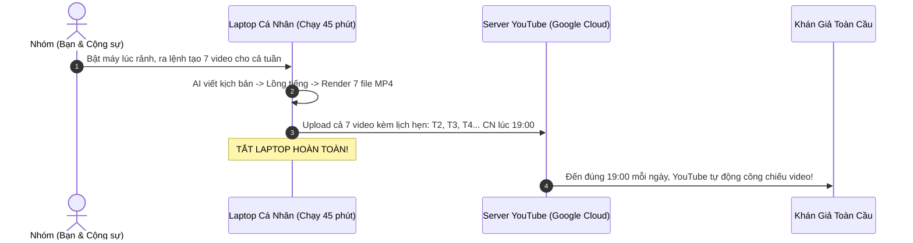
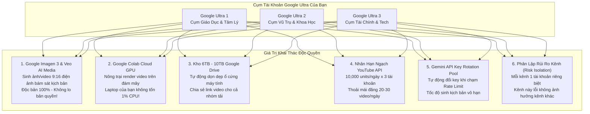
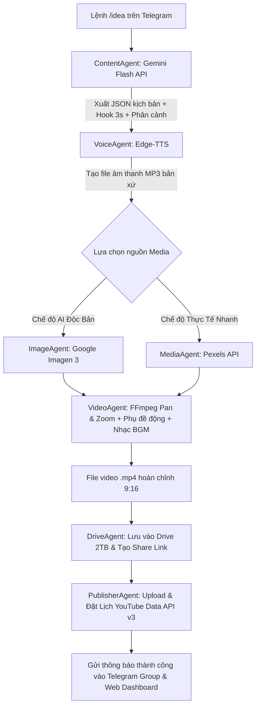

# 📘 TÀI LIỆU TOÀN TẬP: ĐẶC TẢ Ý TƯỞNG & KIẾN TRÚC HỆ THỐNG
# (PROJECT WHITEPAPER & SYSTEM SPECIFICATION)

> **Dự án:** AI YouTube Multi-Channel Studio & Automation Hub  
> **Người sáng lập:** `@Giangvv1n` & **Cộng sự**  
> **Kho mã nguồn GitHub:** [https://github.com/Giangvv1n/AI-youtube](https://github.com/Giangvv1n/AI-youtube)  
> **Phiên bản tài liệu:** v2.0 - Tích hợp AI Video/Hình ảnh Google Ultra (Veo & Imagen 3) và Mạng lưới Kênh đa chủ đề.

---

## 🧭 MỤC LỤC
1. [Tại sao dự án này ra đời? (Tầm nhìn & Cơ hội kinh doanh)](#1-tại-sao-dự-án-này-ra-đời-tầm-nhìn--cơ-hội-kinh-doanh)
2. [Cơ chế "Zero-Burn Laptop" (Làm việc thông minh, không treo máy)](#2-cơ-chế-zero-burn-laptop-làm-việc-thông-minh-không-treo-máy)
3. [Vũ khí tối thượng: Khai thác AI Sẵn Có & Cụm Tài Khoản Google Ultra](#3-vũ-khí-tối-thượng-khai-thác-ai-sẵn-có--cụm-tài-khoản-google-ultra)
4. [Mạng lưới Kênh thương hiệu đa chủ đề (Multi-Brand Channel Network)](#4-mạng-lưới-kênh-thương-hiệu-đa-chủ-đề-multi-brand-channel-network)
5. [Giao diện kép: Telegram Group Chat & Web Dashboard thời gian thực](#5-giao-diện-kép-telegram-group-chat--web-dashboard-thời-gian-thực)
6. [Cơ chế mở rộng: Thêm bớt thành viên & Kênh YouTube cực kỳ dễ dàng](#6-cơ-chế-mở-rộng-thêm-bớt-thành-viên--kênh-youtube-cực-kỳ-dễ-dàng)
7. [Pipeline sản xuất video tự động từ A - Z](#7-pipeline-sản-xuất-video-tự-động-từ-a---z)
8. [Bản đồ lộ trình 5 giai đoạn & Phân chia công việc cho nhóm](#8-bản-đồ-lộ-trình-5-giai-đoạn--phân-chia-công-việc-cho-nhóm)
9. [Hướng dẫn cài đặt nhanh chỉ với 1 dòng lệnh](#9-hướng-dẫn-cài-đặt-nhanh-chỉ-với-1-dòng-lệnh)

---

## 1. TẠI SAO DỰ ÁN NÀY RA ĐỜI? (TẦM NHÌN & CƠ HỘI KINH DOANH)

### 1.1. Thị trường ngách quốc tế (Global / US Market)
Thay vì làm video cho thị trường Việt Nam với doanh thu thấp, hệ thống tập trung sản xuất nội dung **Shorts tiếng Anh** nhắm vào thị trường **Mỹ, Anh, Canada, Úc**:
* **Chênh lệch doanh thu RPM:** 1 triệu view Shorts tại Mỹ mang về **80$ – 250$** (gấp 5 – 10 lần so với mức 10$ – 30$ ở Việt Nam).
* **Nội dung không lộ mặt (Faceless Content):** Tập trung vào các ngách có tỷ lệ giữ chân (retention) và RPM cao nhất:
  1. *Tâm lý học hành vi (Dark Psychology & Mind Hacks)*
  2. *Triết lý sống & Động lực (Daily Stoic & Wisdom)*
  3. *Khoa học & Vũ trụ bí ẩn (Cosmic Odyssey & Space Secrets)*

### 1.2. Thoát khỏi cạm bẫy "Video AI rác"
Đa số người làm tự động hóa thất bại vì lấy stock video đại trà ghép lại, bị YouTube đánh gậy "Nội dung tái sử dụng" (Reused Content). Hệ thống này giải quyết bằng:
* **Hình ảnh & Video AI Độc Bản 100%:** Sử dụng mô hình **Google Imagen 3** và **Google Veo** sẵn có trong gói Ultra để vẽ các phân cảnh độc nhất vô nhị.
* **Hook 3 giây đầu:** Kịch bản giữ chân người xem bằng các câu hỏi mở đầu gây sốc hoặc bí ẩn.

---

## 2. CƠ CHẾ "ZERO-BURN LAPTOP" (LÀM VIỆC THÔNG MINH, KHÔNG TREO MÁY)

Một nỗi lo lớn khi làm tự động hóa là: *"Có phải bật máy tính 24/24 làm server không?"*. **Câu trả lời là KHÔNG!**

Hệ thống hoạt động theo nguyên lý **"Sản xuất theo mẻ (Batch Production) + Đặt lịch YouTube API (`publishAt`)"**:



* **Tiết kiệm tối đa:** Bạn chỉ cần mở laptop khoảng **30 - 45 phút vào cuối tuần**. Sau khi các video đã được tải lên và đặt lịch trên server YouTube của Google, bạn có thể tắt máy tính hoàn toàn.

---

## 3. VŨ KHÍ TỐI THƯỢNG: KHAI THÁC AI SẴN CÓ & CỤM TÀI KHOẢN GOOGLE ULTRA

Mỗi tài khoản **Google Ultra (Google One AI Premium)** của bạn thực chất là một **"Trạm tài nguyên điện toán đám mây & AI cao cấp"**:



### 3.1. Khai Thác AI Tạo Video & Ảnh Của Google Ultra (Imagen 3 & Veo)
* **Vấn đề của stock video:** Dễ bị trùng lặp, không tìm được cảnh đúng ý (ví dụ: *"Marcus Aurelius đứng suy tư trong mưa tuyết"*).
* **Giải pháp với Google Ultra:** Module `ImageAgent` sẽ gọi trực tiếp mô hình **Google Imagen 3 (`imagen-3.0-generate-002`)** để vẽ chính xác cảnh đó theo tỷ lệ dọc 9:16 với độ phân giải siêu cao và ánh sáng điện ảnh (Cinematic Lighting).
* Sau đó, FFmpeg tự động áp dụng hiệu ứng chuyển động **Ken Burns (Pan & Zoom)** để biến bức ảnh thành một đoạn video chuyển động sống động, ma mị!

---

## 4. MẠNG LƯỚI KÊNH THƯƠNG HIỆU ĐA CHỦ ĐỀ (MULTI-BRAND CHANNEL NETWORK)

Một tài khoản Google có thể tạo tối đa **50 Kênh thương hiệu (Brand Channels)**. Do đó, cụm tài khoản Ultra sẽ được tổ chức thành một **Mạng lưới truyền thông đa ngách**:

* **Tài khoản Ultra 1 (Chuyên Cụm Tâm Lý & Phát Triển Bản Thân):**
  * *Kênh 1.1:* Dark Psychology & Mind Hacks (Tâm lý học hành vi)
  * *Kênh 1.2:* Daily Stoic & Ancient Wisdom (Triết lý sống khắc kỷ)
  * *Kênh 1.3:* Book Insights (Tóm tắt sách 60s)
* **Tài khoản Ultra 2 (Chuyên Cụm Khoa Học & Bí Ẩn):**
  * *Kênh 2.1:* Cosmic Odyssey (Vũ trụ & Thiên văn học)
  * *Kênh 2.2:* Unsolved Mysteries (Bí ẩn lịch sử chưa có lời giải)
* **Tài khoản Ultra 3 (Chuyên Cụm Tài Chính & Công Nghệ):**
  * *Kênh 3.1:* AI Tools & Future Tech (Công nghệ tương lai)
  * *Kênh 3.2:* Wealth & Money Mindset (Tư duy tài chính)

---

## 5. GIAO DIỆN KÉP: TELEGRAM GROUP CHAT & WEB DASHBOARD THỜI GIAN THỰC

Hệ thống cung cấp **2 cổng giao tiếp bổ trợ cho nhau hoàn hảo**:

### 5.1. Telegram Group Chat (Điều khiển di động & Thảo luận tức thì)
* Thay vì chat riêng lẻ, Bot được add vào một **Nhóm chat Telegram chung** của nhóm bạn.
* **Quy trình tương tác:**
  1. Thành viên A gõ: `/idea 3 sự thật đen tối về tâm lý học`.
  2. Bot phản hồi kịch bản chi tiết **ngay giữa nhóm chat** cho tất cả mọi người cùng đọc.
  3. Cả nhóm cùng phản biện, chỉnh sửa.
  4. Bất kỳ ai cũng có thể bấm nút tương tác dưới tin nhắn: `[🚀 Duyệt & Dựng Video]`, `[⏰ Lên Lịch]`, `[❌ Hủy]`.

### 5.2. Web Dashboard Thời Gian Thực (`http://localhost:8000`)
Giao diện Web Dark Mode sang trọng, chia thành 4 phân khu chuyên biệt:
1. **Live Activity Feed:** Xem dòng thời gian ai vừa gõ lệnh gì trên Telegram (`@Ban vừa tạo kịch bản...`, `@Giang vừa đổi kênh...`).
2. **Team Leaderboard:** Bảng xếp hạng thành viên, ghi nhận chính xác số lượng video mỗi Admin/Creator đã đóng góp.
3. **Ma Trận Cụm Kênh & Google Ultra:** Kiểm tra trạng thái token YouTube, link kho Drive 2TB và hạn ngạch API.
4. **Video Pipeline:** Xem toàn bộ kịch bản, tiêu đề, tags và link xem trước video.
* **Chia sẻ từ xa cho cả nhóm xem:** Dùng công cụ miễn phí **Cloudflare Tunnel**:
  ```bash
  cloudflared tunnel --url http://localhost:8000
  ```

---

## 6. CƠ CHẾ MỞ RỘNG: THÊM BỚT THÀNH VIÊN & KÊNH YOUTUBE CỰC KỲ DỄ DÀNG

### 6.1. Thêm / Bớt Thành Viên (Admin/Creator):
* **Cực kỳ đơn giản:** Bạn chỉ cần thêm bạn bè vào **Group chat Telegram** là họ có quyền sử dụng bot và được hệ thống tự động ghi nhận vào Dashboard.
* Khi muốn gỡ ai ra, chỉ cần xóa họ khỏi nhóm Telegram!

### 6.2. Thêm / Bớt Kênh YouTube:
* Mọi kênh được cấu hình trong file `config/channels.yaml`.
* Muốn thêm kênh mới, chỉ cần copy 5 dòng mẫu (đổi tên kênh, ngách, tài khoản Google Ultra tương ứng).
* Telegram Bot và Web Dashboard sẽ **tự động cập nhật nút bấm của kênh mới** mà không cần lập trình lại!

---

## 7. PIPELINE SẢN XUẤT VIDEO TỰ ĐỘNG TỪ A - Z



---

## 8. BẢN ĐỒ LỘ TRÌNH 5 GIAI ĐOẠN & PHÂN CHIA CÔNG VIỆC CHO NHÓM

| Giai đoạn | Nội dung công việc | Trạng thái | Phụ trách |
| :--- | :--- | :---: | :---: |
| **Giai đoạn 1** | Khởi tạo khung dự án, Web Dashboard FastAPI, Telegram Bot Nhóm, Cụm KeyRotator, ActivityLog | **HOÀN THÀNH** | `@Giangvv1n` |
| **Giai đoạn 2** | Hoàn thiện prompt Gemini, ImageAgent kết nối Google Imagen 3 của Ultra, VoiceAgent Edge-TTS | **Đang thực hiện** | `@...` |
| **Giai đoạn 3** | Ghép footage AI/Pexels, tạo phụ đề động nhảy từng chữ bằng `whisper-timestamped`, xử lý nhạc nền | **Chờ triển khai** | `@...` |
| **Giai đoạn 4** | Xác thực OAuth2 đa kênh, upload video kèm lịch phát sóng `publishAt`, link Google Drive 2TB | **Chờ triển khai** | `@...` |
| **Giai đoạn 5** | Tích hợp Google Colab Cloud GPU render, tự động xuất Google Sheets Calendar, đăng chéo TikTok | **Mở rộng** | `@...` |

---

## 9. HƯỚNG DẪN CÀI ĐẶT NHANH CHỈ VỚI 1 DÒNG LỆNH

### Bước 1: Kéo mã nguồn về máy
```bash
git clone https://github.com/Giangvv1n/AI-youtube.git
cd AI-youtube
```

### Bước 2: Tạo môi trường ảo & cài đặt thư viện
```bash
python -m venv venv
.\venv\Scripts\activate
pip install -r requirements.txt
```

### Bước 3: Điền API Keys vào file .env
Copy file `.env.example` thành `.env` và điền:
* `TELEGRAM_BOT_TOKEN`: Token bot từ `@BotFather`.
* `ALLOWED_TELEGRAM_GROUPS`: ID nhóm chat Telegram của nhóm bạn.
* `GEMINI_API_KEYS`: Danh sách API Keys từ cụm tài khoản Google Ultra.
* `PEXELS_API_KEY`: Lấy miễn phí tại [pexels.com/api](https://www.pexels.com/api/).

### Bước 4: Khởi động hệ thống (Chạy cả Web & Bot cùng lúc)
```bash
python run.py
```
* **Mở Web Dashboard:** Truy cập [http://localhost:8000](http://localhost:8000) trên trình duyệt.
* **Mở Telegram:** Gõ `/start` hoặc `/idea` trong nhóm chat của bạn để bắt đầu sản xuất video!

---
> 💡 *Tài liệu này được biên soạn đầy đủ để bất kỳ ai khi tham gia vào dự án đều có thể nắm bắt 100% tầm nhìn, kiến trúc kỹ thuật và cách thức vận hành của hệ thống.*
