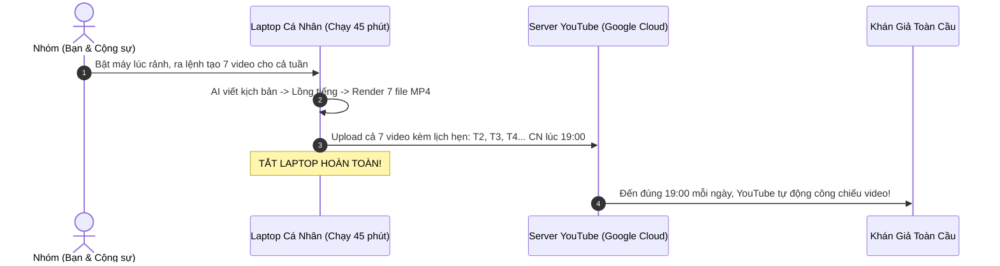
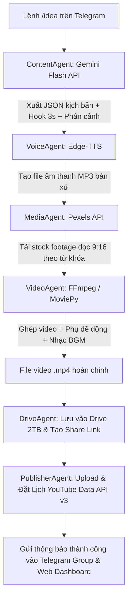

# 📘 TÀI LIỆU TOÀN TẬP: ĐẶC TẢ Ý TƯỞNG & KIẾN TRÚC HỆ THỐNG
# (PROJECT WHITEPAPER & SYSTEM SPECIFICATION)

> **Dự án:** AI YouTube Multi-Channel Studio & Automation Hub  
> **Người sáng lập:** `@Giangvv1n` & **Cộng sự**  
> **Kho mã nguồn GitHub:** [https://github.com/Giangvv1n/AI-youtube](https://github.com/Giangvv1n/AI-youtube)  
> **Phiên bản tài liệu:** v1.0 - Bản chuẩn dành cho cộng tác viên và đối tác phát triển.

---

## 🧭 MỤC LỤC
1. [Tại sao dự án này ra đời? (Tầm nhìn & Cơ hội kinh doanh)](#1-tại-sao-dự-án-này-ra-đời-tầm-nhìn--cơ-hội-kinh-doanh)
2. [Cơ chế "Zero-Burn Laptop" (Làm việc thông minh, không treo máy)](#2-cơ-chế-zero-burn-laptop-làm-việc-thông-minh-không-treo-máy)
3. [Vũ khí bí mật: Tối ưu cụm tài khoản Google Ultra (Google One AI Premium)](#3-vũ-khí-bí-mật-tối-ưu-cụm-tài-khoản-google-ultra)
4. [Giao diện kép: Telegram Group Chat & Web Dashboard thời gian thực](#4-giao-diện-kép-telegram-group-chat--web-dashboard-thời-gian-thực)
5. [Cơ chế mở rộng: Thêm bớt thành viên & Kênh YouTube cực kỳ dễ dàng](#5-cơ-chế-mở-rộng-thêm-bớt-thành-viên--kênh-youtube-cực-kỳ-dễ-dàng)
6. [Pipeline sản xuất video tự động từ A - Z](#6-pipeline-sản-xuất-video-tự-động-từ-a---z)
7. [Bản đồ lộ trình 5 giai đoạn & Phân chia công việc cho nhóm](#7-bản-đồ-lộ-trình-5-giai-đoạn--phân-chia-công-việc-cho-nhóm)
8. [Hướng dẫn cài đặt nhanh chỉ với 1 dòng lệnh](#8-hướng-dẫn-cài-đặt-nhanh-chỉ-với-1-dòng-lệnh)

---

## 1. TẠI SAO DỰ ÁN NÀY RA ĐỜI? (TẦM NHÌN & CƠ HỘI KINH DOANH)

### 1.1. Thị trường ngách quốc tế (Global / US Market)
Thay vì làm video cho thị trường Việt Nam với doanh thu thấp, hệ thống tập trung sản xuất nội dung **Shorts tiếng Anh** nhắm vào thị trường **Mỹ, Anh, Canada, Úc**:
* **Chênh lệch doanh thu RPM:** 1 triệu view Shorts tại Mỹ mang về **80$ – 250$** (gấp 5 – 10 lần so với mức 10$ – 30$ ở Việt Nam).
* **Nội dung không lộ mặt (Faceless Content):** Tập trung vào 2 ngách có tỷ lệ giữ chân (retention) và RPM cao nhất:
  1. *Tâm lý học hành vi (Dark Psychology & Mind Hacks)*
  2. *Triết lý sống & Động lực (Daily Stoic & Wisdom)*

### 1.2. Giải pháp khắc phục sai lầm của 90% người làm video AI
Đa số thất bại vì làm video "rác", spam nội dung vô nghĩa khiến YouTube bóp tương tác. Hệ thống này giải quyết bằng:
* **Hook 3 giây đầu giữ chân người xem:** AI được huấn luyện bằng prompt chuyên sâu để tạo tiêu đề và câu mở đầu giật tít, khơi gợi tò mò.
* **Nghe nhìn chuẩn chất lượng cao:** Giọng đọc AI bản xứ của Microsoft Edge (ngữ điệu tự nhiên 99%), video footage tỷ lệ dọc 9:16 chất lượng cao từ Pexels, phụ đề động nhảy từng chữ phong cách Alex Hormozi.

---

## 2. CƠ CHẾ "ZERO-BURN LAPTOP" (LÀM VIỆC THÔNG MINH, KHÔNG TREO MÁY)

Một nỗi lo lớn khi làm tự động hóa là: *"Có phải bật máy tính 24/24 làm server không?"*. **Câu trả lời là KHÔNG!**

Hệ thống hoạt động theo nguyên lý **"Sản xuất theo mẻ (Batch Production) + Đặt lịch YouTube API (`publishAt`)"**:



* **Tiết kiệm tối đa:** Bạn chỉ cần mở laptop khoảng **30 - 45 phút vào cuối tuần**. Sau khi các video đã được tải lên và đặt lịch trên server YouTube của Google, bạn có thể tắt máy tính hoàn toàn.

---

## 3. VŨ KHÍ BÍ MẬT: TỐI ƯU CỤM TÀI KHOẢN GOOGLE ULTRA

Dự án được tối ưu hóa đặc biệt cho người sở hữu nhiều tài khoản **Google Ultra (Google One AI Premium)** nhằm giải quyết 3 bài toán lớn nhất:

```mermaid
graph TD
    subgraph "Cụm Tài Khoản Google Ultra Của Nhóm"
        ACC1[Google Ultra 1\nKênh Tâm Lý]
        ACC2[Google Ultra 2\nKênh Triết Lý]
        ACC3[Google Ultra 3\nKênh Khoa Học]
    end

    subgraph "Giá Trị Khai Thác Vượt Trội"
        DRIVE[Kho 6TB - 10TB Google Drive\n- Tự động dọn dẹp ổ cứng máy\n- Cả nhóm cùng truy cập link tải]
        QUOTA[Nhân Hạn Ngạch YouTube API\n- 10,000 units/ngày x 3 tài khoản\n- Thoải mái up 20-30 video/ngày]
        ROTATOR[Bộ Xoay Vòng Gemini API Pool\n- Tự động nhảy key khi chạm Rate Limit\n- Tốc độ sinh kịch bản vô hạn]
        RISK[Phân Lập Rủi Ro Kênh (Risk Isolation)\n- Mỗi kênh 1 tài khoản riêng biệt\n- Kênh này lỗi không ảnh hưởng kênh khác]
    end

    ACC1 --> DRIVE
    ACC1 --> QUOTA
    ACC1 --> ROTATOR
    ACC1 --> RISK

    ACC2 --> DRIVE
    ACC2 --> QUOTA
    ACC2 --> ROTATOR
    ACC2 --> RISK

    ACC3 --> DRIVE
    ACC3 --> QUOTA
    ACC3 --> ROTATOR
    ACC3 --> RISK
```

---

## 4. GIAO DIỆN KÉP: TELEGRAM GROUP CHAT & WEB DASHBOARD THỜI GIAN THỰC

Hệ thống cung cấp **2 cổng giao tiếp bổ trợ cho nhau hoàn hảo**:

### 4.1. Telegram Group Chat (Điều khiển di động & Thảo luận tức thì)
* Thay vì chat riêng lẻ, Bot được add vào một **Nhóm chat Telegram chung** của nhóm bạn.
* **Quy trình tương tác:**
  1. Thành viên A gõ: `/idea 3 sự thật đen tối về tâm lý học`.
  2. Bot phản hồi kịch bản chi tiết **ngay giữa nhóm chat** cho tất cả mọi người cùng đọc.
  3. Cả nhóm cùng phản biện, chỉnh sửa.
  4. Bất kỳ ai cũng có thể bấm nút tương tác dưới tin nhắn: `[🚀 Duyệt & Dựng Video]`, `[⏰ Lên Lịch]`, `[❌ Hủy]`.

### 4.2. Web Dashboard Thời Gian Thực (`http://localhost:8000`)
Giao diện Web Dark Mode sang trọng, chia thành 4 phân khu chuyên biệt:
1. **Live Activity Feed:** Xem dòng thời gian ai vừa gõ lệnh gì trên Telegram (`@Ban vừa tạo kịch bản...`, `@Giang vừa đổi kênh...`).
2. **Team Leaderboard:** Bảng xếp hạng thành viên, ghi nhận chính xác số lượng video mỗi Admin/Creator đã đóng góp.
3. **Ma Trận Cụm Kênh & Google Ultra:** Kiểm tra trạng thái token YouTube, link kho Drive 2TB và hạn ngạch API.
4. **Video Pipeline:** Xem toàn bộ kịch bản, tiêu đề, tags và link xem trước video.
* **Chia sẻ từ xa cho cả nhóm xem:** Dùng công cụ miễn phí **Cloudflare Tunnel**:
  ```bash
  cloudflared tunnel --url http://localhost:8000
  ```
  *(Cung cấp ngay link HTTPS công khai để bạn bè ở bất cứ đâu cũng vào Dashboard được)*.

---

## 5. CƠ CHẾ MỞ RỘNG: THÊM BỚT THÀNH VIÊN & KÊNH YOUTUBE CỰC KỲ DỄ DÀNG

Hệ thống được thiết kế theo tư duy **"Không đụng vào code khi mở rộng"**:

### 5.1. Thêm / Bớt Thành Viên (Admin/Creator):
* **Cực kỳ đơn giản:** Bạn chỉ cần thêm bạn bè vào **Group chat Telegram** là họ có quyền sử dụng bot và được hệ thống tự động ghi nhận vào Dashboard.
* Khi muốn gỡ ai ra, chỉ cần xóa họ khỏi nhóm Telegram!

### 5.2. Thêm / Bớt Kênh YouTube:
* Mọi kênh được cấu hình trong file `config/channels.yaml`.
* Muốn thêm kênh mới, chỉ cần copy 5 dòng mẫu (đổi tên kênh, ngách, tài khoản Google Ultra tương ứng).
* Telegram Bot và Web Dashboard sẽ **tự động cập nhật nút bấm của kênh mới** mà không cần lập trình lại!

---

## 6. PIPELINE SẢN XUẤT VIDEO TỰ ĐỘNG TỪ A - Z



---

## 7. BẢN ĐỒ LỘ TRÌNH 5 GIAI ĐOẠN & PHÂN CHIA CÔNG VIỆC CHO NHÓM

| Giai đoạn | Nội dung công việc | Trạng thái | Phụ trách |
| :--- | :--- | :---: | :---: |
| **Giai đoạn 1** | Khởi tạo khung dự án, cấu hình Git, Web Dashboard FastAPI, Telegram Bot Nhóm, Cơ chế ghi log hoạt động | **HOÀN THÀNH** | `@Giangvv1n` |
| **Giai đoạn 2** | Hoàn thiện prompt Gemini chuẩn CTR cho ngách Tâm lý/Stoic, Edge-TTS tạo file mp3, tính năng gửi file nghe thử qua Telegram | **Đang thực hiện** | `@...` |
| **Giai đoạn 3** | Ghép footage Pexels, tạo phụ đề động nhảy từng chữ bằng `whisper-timestamped`, xử lý âm lượng nhạc nền (Audio Ducking) | **Chờ triển khai** | `@...` |
| **Giai đoạn 4** | Xác thực OAuth2 đa kênh, upload video kèm lịch phát sóng `publishAt`, tạo link chia sẻ Google Drive 2TB | **Chờ triển khai** | `@...` |
| **Giai đoạn 5** | Tự động quét tin tức trend từ Reddit/X đề xuất ý tưởng mỗi sáng, tự tạo Thumbnail bằng Pillow, tự động đăng chéo lên TikTok | **Mở rộng** | `@...` |

---

## 8. HƯỚNG DẪN CÀI ĐẶT NHANH CHỈ VỚI 1 DÒNG LỆNH

### Bước 1: Kéo mã nguồn về máy
```bash
git clone https://github.com/Giangvv1n/AI-youtube.git
cd AI-youtube
```

### Bước 2: Tạo môi trường ảo & cài đặt thư viện
```bash
python -m venv venv
.\venv\Scripts\activate
pip install -r requirements.txt
```

### Bước 3: Điền API Keys vào file .env
Copy file `.env.example` thành `.env` và điền:
* `TELEGRAM_BOT_TOKEN`: Token bot từ `@BotFather`.
* `ALLOWED_TELEGRAM_GROUPS`: ID nhóm chat Telegram của nhóm bạn.
* `GEMINI_API_KEYS`: Danh sách API Keys từ cụm tài khoản Google Ultra.
* `PEXELS_API_KEY`: Lấy miễn phí tại [pexels.com/api](https://www.pexels.com/api/).

### Bước 4: Khởi động hệ thống (Chạy cả Web & Bot cùng lúc)
```bash
python run.py
```
* **Mở Web Dashboard:** Truy cập [http://localhost:8000](http://localhost:8000) trên trình duyệt.
* **Mở Telegram:** Gõ `/start` hoặc `/idea` trong nhóm chat của bạn để bắt đầu sản xuất video!

---
> 💡 *Tài liệu này được biên soạn đầy đủ để bất kỳ ai khi tham gia vào dự án đều có thể nắm bắt 100% tầm nhìn, kiến trúc kỹ thuật và cách thức vận hành của hệ thống.*
