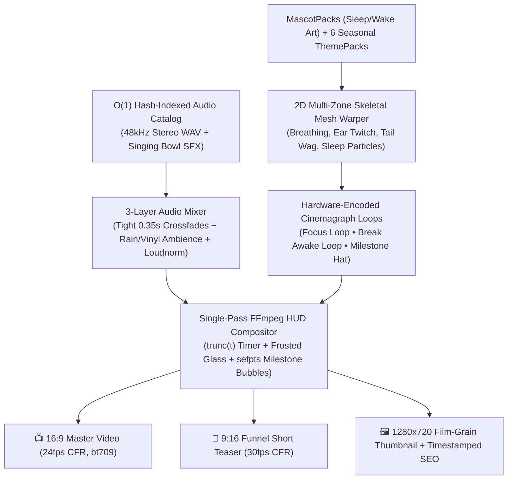

<div align="center">

# 🎬 AI YouTube Studio — Hệ Thống Tự Động Hóa Sản Xuất & Quản Trị Vận Hành Đa Kênh
### Autonomous Multi-Agent Media Production, SQLAlchemy ORM & Multi-Channel Operations Platform

[](https://github.com/Kizakawa/AI-YouTube-Studio/actions/workflows/ci.yml)
[-003B57?logo=postgresql&logoColor=white)](#)
[-3776AB?logo=python&logoColor=white)](https://www.python.org/)
[](#)
[](#testing--quality-assurance)

*Hệ thống tự động hóa sản xuất và quản trị vận hành 9 kênh nội dung số quy mô lớn (242 module Python, 179 kiểm thử tự động): tích hợp tầng truy xuất CSDL SQLAlchemy ORM (tự động chuyển đổi dự phòng PostgreSQL ↔ SQLite WAL), điều phối quy trình đa tác tử LangGraph và quản lý hạn ngạch đa tài khoản.*

[🇻🇳 Tổng quan Nghiệp vụ & Kỹ thuật](#-tóm-tắt-dự-án--điểm-nhấn-năng-lực-tiếng-việt) •
[📖 Tài liệu Kiến trúc (`docs/ARCHITECTURE.md`)](docs/ARCHITECTURE.md) •
[🏛️ Sơ đồ Hệ thống](#system-architecture) •
[🧪 Kiểm thử Tự động (179 Tests)](#testing--quality-assurance) •
[🚀 Hướng dẫn Cài đặt](#-getting-started)

</div>

---

## 🇻🇳 Tóm Tắt Dự Án & Điểm Nhấn Năng Lực (Tiếng Việt)

**AI YouTube Studio** là nền tảng phần mềm tự động hóa quy trình sản xuất nội dung và quản trị vận hành đa kênh quy mô thực tế (**242 module Python**, **179 bài kiểm thử tự động `pytest`**), được thiết kế theo kiến trúc phân tầng chặt chẽ:

| Góc Nhìn Đánh Giá | Giải Pháp Kỹ Thuật & Nghiệp Vụ Đã Triển Khai Trong Dự Án |
| :--- | :--- |
| **🗄️ Thiết Kế CSDL & Quản Trị Dữ Liệu**<br>*(SQLAlchemy ORM & Failover)* | • **Tầng Lưu trữ Bền vững (`PostgreSQL` $\leftrightarrow$ `SQLite WAL`):** Thiết kế các bảng quản lý danh mục Kênh (`channels`), Lịch sử sản xuất & phát hành (`videos`, `publish_logs`), Chỉ số phân tích hiệu quả (`analytics_metrics`) và Kho chữ ký chống trùng lặp (`video_memory_rag`).<br>• **Tự động Chuyển đổi Dự phòng (`Database Failover`):** Hệ thống tự động kiểm tra kết nối PostgreSQL khi khởi động và chuyển đổi mượt mà sang SQLite (`WAL mode`) nếu máy chủ CSDL từ xa gián đoạn, được kiểm chứng qua `tests/test_database_scenarios.py`. |
| **📋 Phân Tích Nghiệp Vụ & Điều Phối Quy Trình**<br>*(Workflow & Operations BA)* | • **Chuẩn hóa Quy trình Nghiệp vụ 7 Công đoạn:** Mô hình hóa luồng công việc từ *Phân tích xu hướng $\rightarrow$ Khởi tạo kịch bản theo hợp đồng dữ liệu (`Pydantic Schema`) $\rightarrow$ Kiểm định chất lượng nội dung $\rightarrow$ Tổng hợp âm thanh & hình ảnh $\rightarrow$ Kiểm duyệt thị giác $\rightarrow$ Xuất bản đa kênh & Thu thập báo cáo Analytics*.<br>• **Quản lý Hạn ngạch Đa Tài khoản (`Quota & Pool Isolation`):** Phân bổ tự động 9 kênh vào 7 cụm tài khoản Google Cloud OAuth độc lập và xoay vòng khóa API (`KeyRotator`) để không bao giờ bị gián đoạn vận hành khi chạm trần hạn mức. |
| **🚀 Phát Triển Sản Phẩm & Kiểm Thử Tự Động**<br>*(Product Dev & Automated QA)* | • **Quy mô 242 Modules & 179 Bài Kiểm thử (`pytest`):** Bao phủ toàn diện các kịch bản lỗi cơ sở dữ liệu (`test_database_scenarios.py`), kịch bản cạn kiệt hạn mức (`test_quota_scenarios.py`), đồng bộ cấu hình kênh và kiểm định đầu ra.<br>• **Vận hành Đa giao diện:** Cung cấp đồng thời **Web Dashboard (`FastAPI`)**, **Telegram Operations Bot** và **CLI** cùng quy trình tự động hóa lịch trình qua **GitHub Actions**. |

---

## 💡 Why This Project Matters (Engineering Overview)

Most "AI video generators" fail in production due to four systemic bottlenecks: **visual hallucinations/watermarks**, **repetitive stock clips**, **API rate-limit cascades (`HTTP 429`)**, and **sub-pixel FFmpeg jitter / audio-video drift**.

**AI YouTube Studio** was engineered from the ground up as a fault-tolerant, deterministic production system:

| Production Challenge | Architectural Solution Implemented | Measured Result |
| :--- | :--- | :--- |
| **Visual Mismatch & Watermarks** | **3-Frame Multimodal Gemini Vision Gate** + OpenCV Laplacian sharpness & aspect-ratio pre-filters before timeline commitment | **Zero** watermarked or off-topic clips in final render |
| **Scene & Topic Repetition** | **Perceptual `Mini-RAG` (`VideoMemoryRAG`)** indexing 3-frame `dHash` signatures + cross-channel semantic title deduplication | **0%** duplicate scene reuse within or across episodes |
| **Sub-Pixel Pan Jitter & Drift** | **2.5x LANCZOS Supersampled `zoompan`**, locked Constant Frame Rate (`CFR`), `bt709` broadcast color space, `tpad=stop_mode=clone`, and **EBU R128 (`-14 LUFS`)** mastering | **`0` frozen frames**, **`< 35ms` A/V drift**, `0` bitstream decode errors |
| **Quota Exhaustion (`429` / OAuth)** | **Parallel `KeyRotator`** (30s/30m health isolation) + **7-Pool Google Cloud OAuth Isolation** with staggered Golden-Hour scheduling | Uninterrupted multi-channel publishing across US & BR timezones |
| **Long-Form Flow Production** | **Living Studio v2.0 Engine** with 2D skeletal mesh mascot breathing/ear/tail physics, seasonal particles, and interactive Break wake-up states | Automated `16:9` study/music sessions + auto-cut `9:16` Short teasers |

---

## 🖼️ Rendered Output Showcase

<div align="center">
<table>
  <tr>
    <td align="center" width="50%">
      
      <br/><sub><b>Living Studio v2.0 (16:9 Focus Phase):</b> 2D skeletal breathing mascot, seasonal snow particles, frosted-glass timer HUD & live audio waveform.</sub>
    </td>
    <td align="center" width="50%">
      
      <br/><sub><b>Interactive Break State (16:9):</b> Singing-bowl bell trigger transitions mascot to dedicated waking artwork with contextual stretch/hydration prompt.</sub>
    </td>
  </tr>
  <tr>
    <td align="center" width="50%">
      
      <br/><sub><b>9:16 Documentary/Music Short (1080x1920 @ 30fps CFR):</b> 2.5x supersampled camera pan + word-level ASS Karaoke locked in <code>MarginV=420</code> UI Safe Zone.</sub>
    </td>
    <td align="center" width="50%">
      
      <br/><sub><b>Automated 9:16 Funnel Teaser:</b> Auto-extracted from Long-Form master with zero-drift 30fps CFR transcode to drive long-form watch time.</sub>
    </td>
  </tr>
</table>
</div>

---

## 🏗️ System Architecture

### 1. Autonomous LangGraph Multi-Agent Pipeline (`Shorts 9:16` & `Documentary 16:9`)

```mermaid
flowchart LR
    subgraph Triggers["Control Plane"]
        WEB["🌐 FastAPI Web Dashboard"]
        TG["📱 Telegram Bot Ops"]
        SCHED["⏰ Smart Golden-Hour Scheduler"]
    end

    Triggers --> RUNNER["LangGraph StateGraph Runner\n(Checkpointed SQLite WAL / PostgreSQL)"]

    subgraph Graph["Multi-Agent Production DAG (app/graph)"]
        direction LR
        S["1. ContentAgent + Critic Loop\nPydantic ScriptContract + Hot-Script Benchmark"]
        T["2. VoiceAgent (5-Tier TTS)\nWord-Level Karaoke ASS + Exact Duration Lock"]
        M["3. 48-Worker Parallel Media Race\nPexels • Pixabay • Wikimedia • CC-BY • Bilibili"]
        V["4. Multimodal Vision Critic + dHash RAG\n3-Frame Inspection + Zero-Duplicate Gate"]
        R["5. GPU FFmpeg Render Engine\n2.5x Supersampled Zoompan + XFade + -14 LUFS"]
        Q["6. Deterministic VideoQA Gate\nffprobe CFR / bt709 / Drift / Sharpness"]
        S --> T --> M --> V --> R --> Q
    end

    RUNNER --> Graph
    Q --> PUB["🚀 PublisherAgent\n7-Pool OAuth2 + SEO Chapters + CC Attribution"]
    PUB --> ANALYTICS["📊 YouTube Analytics API v2\nReal APV% & Retention Feedback Loop"]
    ANALYTICS -. "Closed-Loop Retention Signal" .-> S
```



### 2. Living Studio v2.0 Engine (`app/services/pomodoro`)



---

## ⚡ Key Engineering Capabilities

- **Strict Semantic-vs-Deterministic Separation:** Creative storytelling, entity extraction, and visual relevance live in structured LLM/Vision prompts + declarative YAML niche blueprints (`config/niches/*.yaml`), while schema validation, frame-rate locking, perceptual hashing, and loudness normalization are 100% deterministic Python/FFmpeg gates.
- **$O(1)$ Multi-Niche Audio Catalog (`assets/bgm/audio_catalog.json`):** Instant mood-and-trigger track resolution across 7 niche audio pools without runtime disk scanning, backed by `mtime`-aware hot reloading.
- **Hardware-Accelerated Encoding with Graceful Fallback:** Probes `h264_nvenc` (NVIDIA GPU) $\rightarrow$ `h264_qsv` (Intel QuickSync) $\rightarrow$ `libx264` CPU automatically, maintaining uniform `yuv420p` + `bt709` output across Windows and Linux/WSL2.
- **Cloud-Native 7x/Day Telemetry (`.github/workflows/channel_audit_7x.yml`):** Stateless standalone auditor capable of running on GitHub Actions cron schedules, persisting state to an isolated orphan branch (`audit-logs`) without polluting `main`.

---

## 📂 Repository Structure

```text
AI-YouTube-Studio/
├── run.py                          # Unified entrypoint (FastAPI Dashboard + Async Telegram Bot)
├── config/
│   ├── settings.py                 # Typed environment settings & canonical 9-channel registry
│   ├── channels.example.yaml       # Multi-account OAuth pool & channel template
│   └── niches/                     # Declarative YAML blueprints (7 content/music verticals)
├── app/
│   ├── graph/                      # LangGraph StateGraph, nodes, @tools & 5 QA Evaluators
│   ├── agents/                     # Specialized Agents (Content, Voice, VisualCuration, Video, Publisher)
│   ├── services/
│   │   ├── pomodoro/               # Living Studio v2.0 (2D Mascot Engine, VFX, HUD, Audio Mixer, CLI)
│   │   ├── intelligence/           # Viral Topic Hunter, Deduplication & Competitor Analytics
│   │   ├── media/                  # CC-BY License Verifier, Stock/Archive Fetchers, dHash QA
│   │   ├── smart_scheduler.py      # Timezone-aware staggered Golden-Hour scheduler
│   │   ├── quota_manager.py        # Multi-project Google Cloud YouTube API quota guard
│   │   └── video_memory_rag.py     # Perceptual dHash & semantic Mini-RAG store
│   ├── web/                        # FastAPI routers & real-time control dashboard
│   ├── bot/                        # Telegram Bot command & callback handlers
│   ├── database/                   # SQLAlchemy ORM (PostgreSQL / SQLite WAL auto-failover)
│   ├── schemas/                    # Strict Pydantic v2 contracts (ScriptContract, SceneContract)
│   └── utils/                      # Parallel KeyRotator, modular FFmpeg suite & ASS SubtitleHelper
├── assets/                         # O(1) BGM/SFX catalog, 5 MascotPacks, 6 Seasonal ThemePacks, Fonts
├── docs/                           # System architecture deep-dive & showcase media
└── tests/                          # 179 unit & integration tests across pipeline, RAG, quota & FFmpeg
```

---

## 🚀 Getting Started

### Prerequisites
- **Python 3.11+**
- **FFmpeg & FFprobe** installed in `PATH` (`winget install Gyan.FFmpeg.Essentials` on Windows or `sudo apt install ffmpeg` on Ubuntu/WSL2)

### Installation

```bash
git clone https://github.com/Kizakawa/AI-YouTube-Studio.git
cd AI-YouTube-Studio

python -m venv venv
# Windows:
.\venv\Scripts\activate
# Linux / macOS:
source venv/bin/activate

pip install -r requirements.txt
cp .env.example .env
cp config/channels.example.yaml config/channels.yaml
```

### Running the Platform

```bash
# 1. Launch Web Dashboard (http://localhost:8000) + Telegram Ops Bot
python run.py

# 2. Or render a standalone Living Studio v2.0 Pomodoro Session + 9:16 Short Teaser via CLI
python -m app.services.pomodoro.cli \
  --mode lofi_focus \
  --mascot golden_retriever \
  --theme christmas_lofi \
  --focus-min 25 --break-min 5 --sessions 2 \
  --speech-lang en --cut-short
```

---

## 🧪 Testing & Quality Assurance

The codebase is continuously verified via bytecode compilation and **179 `pytest` unit & integration tests**:

```bash
# Compile-check all 242 Python modules
python -m compileall -q app config tests

# Run deterministic core test suite (offline-safe, zero API keys required)
pytest tests/test_pomodoro_and_channel_sync.py \
       tests/test_dual_track_search_and_cv_gate.py \
       tests/test_mpt_enhancements.py \
       tests/test_quota_scenarios.py \
       tests/test_database_scenarios.py \
       tests/test_verification.py -q

# Run full repository test suite (with .env configured)
pytest tests/ --ignore=tests/test_render_pipeline.py -q
```

---

## 🇻🇳 Tóm Tắt Dự Án Dành Cho Nhà Tuyển Dụng (Tiếng Việt)

**AI YouTube Studio** là nền tảng tự động hóa sản xuất nội dung số và vận hành đa kênh YouTube quy mô sản xuất thực tế (**242 module Python**, **179 bài kiểm thử tự động**), kết hợp giữa **Kiến trúc Multi-Agent (LangGraph)**, **Thị giác máy tính đa phương thức (Gemini Vision + OpenCV)** và **Kỹ thuật xử lý âm thanh/hình ảnh phần cứng (FFmpeg GPU)**:

1. **Điều phối Multi-Agent tự phục hồi (`LangGraph`):** Tự động hóa khép kín từ săn chủ đề $\rightarrow$ viết kịch bản chuẩn `Pydantic Contract` $\rightarrow$ chấm điểm phản biện đa vòng (`ScriptCritic`) $\rightarrow$ thu âm đa tầng & tạo phụ đề Karaoke từng từ $\rightarrow$ đua tải tư liệu 48 luồng song song.
2. **Kiểm định Thị giác & Chống trùng lặp (`Mini-RAG`):** Chấm điểm 3 khung hình bằng Multimodal Vision và băm thị giác `dHash` để loại bỏ 100% cảnh dính watermark, lệch chủ thể hoặc trùng lặp.
3. **Engine Dựng Hình Mượt Chuẩn Phát Sóng:** Nâng mẫu siêu phân giải `2.5x Supersampled Ken Burns`, khóa `CFR` + không gian màu `bt709`, trộn âm thanh 3 lớp chuẩn `EBU R128 (-14 LUFS)` với độ lệch A/V `< 35ms`, tích hợp bộ dựng **Living Studio v2.0** (hoạt ảnh xương 2D cho linh vật ngủ/thức theo hiệp Pomodoro).
4. **Hạ tầng Chịu Lỗi Đa Tài Khoản:** Tự động xoay vòng cụm khóa API (`KeyRotator`), cách ly hạn ngạch trên 7 cụm Google Cloud OAuth cho 9 kênh, tự động chuyển đổi dự phòng `PostgreSQL` $\leftrightarrow$ `SQLite WAL` và `GPU NVENC/QSV` $\leftrightarrow$ `CPU`.

---

<div align="center">

**Tác giả:** **Phan Quốc Bảo (Kizakawa) — Sinh viên ngành Khoa học máy tính** • 📧 [vivyngocnghech@gmail.com](mailto:vivyngocnghech@gmail.com)  
[⬅️ **Quay lại Trang chủ Portfolio GitHub (@Kizakawa)**](https://github.com/Kizakawa)

</div>
