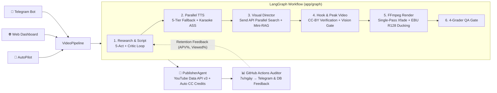

# 🎬 AI YouTube Studio — Hệ Thống Sản Xuất & Vận Hành Đa Kênh YouTube Shorts Tự Động

> 📖 **Tài liệu liên quan:**
> - **[Đặc Tả Ý Tưởng & Kiến Trúc Hệ Thống (PROJECT_WHITEPAPER.md)](PROJECT_WHITEPAPER.md)**
> - **[Lộ Trình Phát Triển (ROADMAP.md)](ROADMAP.md)**
> - **[Nhật Ký Thay Đổi (CHANGELOG.md)](CHANGELOG.md)**

Hệ thống tự động hóa khép kín từ **Nghiên cứu chủ đề → Viết kịch bản 5-Act → Thu âm đa tầng → Săn & Kiểm duyệt Visual bằng AI Vision → Dựng FFmpeg 1080×1920 30fps → Đặt lịch xuất bản & Kiểm toán Analytics** cho cụm 7 kênh YouTube đa ngôn ngữ (`en`, `pt-BR`), điều khiển song song qua **Telegram Bot** và **Web Dashboard**.

---

## 🏗️ Kiến Trúc Pipeline (LangGraph Multi-Agent)



---

## 🌟 Tính Năng Cốt Lõi

### 1. 🧠 Kịch Bản 5-Act & Vòng Phản Hồi Số Liệu Thật (Retention Feedback Loop)
- **Cấu trúc 5-Act Thời lượng vàng (33–40.5s):** Hook gây sốc trong 2.2s đầu, nhịp đọc phát thanh tự nhiên, vòng lặp âm thanh mượt ở cuối video.
- **Học từ YouTube Analytics thật:** Tự động đồng bộ chỉ số giữ chân (`AVD`, `APV%`, `Viewed%` vs `Swiped Away%`) từ YouTube Analytics API v2 để nhân bản DNA của các video thắng và tránh lặp lại mô-típ bị vuốt bỏ cao.
- **Script Critic & Content Linter:** Tự động chấm điểm và tinh chỉnh kịch bản tối đa 5 vòng trước khi chuyển sang bước thu âm.

### 2. 🎥 Săn & Tuyển Chọn Hình Ảnh/Video Đa Luồng (`Send` API + Mini-RAG)
- **Thực thi song song (`LangGraph Send API`):** Quét đồng thời 5 nguồn ảnh/video (Pexels HD, Pixabay, Wikimedia Commons, Openverse, YouTube Creative Commons & AI Image).
- **Chính sách Bản quyền Miễn phí & Tự động (`license_policy.py`):**
  - Mặc định (`MEDIA_LICENSE_MODE=cc_only`) chỉ tìm và tái sử dụng footage YouTube có giấy phép **Creative Commons Attribution (CC BY)**, xác minh trường `license` trước khi tải và **tự động ghi nguồn tác giả** vào cuối phần mô tả video.
- **Cổng Kiểm duyệt Thị giác (`VisualCritic` & Gemini Vision):**
  - Kiểm tra từng clip trước khi ghép: độ phân giải tối thiểu `720p`, độ sắc nét (Laplacian sharpness), cân bằng sáng và loại bỏ clip dính watermark/caption lạ.
- **Mini-RAG (`VideoMemoryRAG`):** Chống trùng lặp cảnh cắt trong cùng 1 video bằng chữ ký thị giác 3-frame `dHash` và đối chiếu lịch sử các video đã đăng lên YouTube.

### 3. 🗣️ Giọng Đọc Bản Xứ & Kết Xuất Điện Ảnh (FFmpeg 1080×1920)
- **Thu âm song song & Dự phòng 5 tầng (`VoiceAgent`):** Ưu tiên giọng đọc tự nhiên theo từng ngôn ngữ kênh (`en`, `pt-BR`), tự động tạo phụ đề Karaoke ASS khớp từng từ.
- **Single-Pass Xfade & Smooth Motion:** Ghép chuyển cảnh mượt kết hợp ép phụ đề trong 1 lượt nén, tích hợp hiệu ứng chuyển động camera nhẹ (crop drift) không gây rung pixel.
- **Chuẩn Âm thanh Phát sóng (`EBU R128`):** Tự động trộn nhạc nền (BGM) và hiệu ứng âm thanh (SFX) với bộ lọc `sidechaincompress` (tự động hạ nhạc nền khi có giọng đọc) và chuẩn hóa âm lượng ở mức `-14 LUFS`.

### 4. 🤖 Tự Động Hóa Đa Kênh & Giám Sát Đám Mây 24/7
- **AutoPilot & Smart Scheduler:** Tự động kiểm tra hàng đợi 3 video/kênh, phân bổ khung giờ vàng theo múi giờ từng thị trường (Mỹ / Brazil) và tự động gắn bộ từ khóa SEO thông minh.
- **7x Daily Standalone Auditor (`.github/workflows/channel_audit_7x.yml`):** Chạy tự động 7 khung giờ mỗi ngày trên GitHub Actions (00:00, 06:00, 09:00, 12:00, 15:00, 18:00, 21:00 VN) ngay cả khi tắt máy tính cá nhân, gửi báo cáo phân tích thẳng về nhóm Telegram.

---

## 📁 Cấu Trúc Thư Mục

```text
Youtube/
├── run.py                         # Điểm khởi chạy chính (Telegram Bot + FastAPI Dashboard)
├── tunnel.py                      # Tự động mở Cloudflare Tunnel chia sẻ Dashboard từ xa
├── auth_all.py / auth_channel.py  # Công cụ xác thực & kiểm tra sức khỏe OAuth 7 kênh
├── requirements.txt               # Danh sách thư viện Python
├── .env.example                   # Mẫu cấu hình biến môi trường
│
├── .github/workflows/
│   └── channel_audit_7x.yml       # GitHub Actions kiểm toán 7 kênh 7 lần/ngày
│
├── config/
│   ├── settings.py                # Quản lý cấu hình & xoay vòng cụm Gemini API Keys
│   └── channels.yaml              # Cấu hình chi tiết 7 kênh YouTube (ngách, giọng đọc, lịch đăng)
│
├── app/
│   ├── graph/                     # Bộ máy điều phối LangGraph (Workflow, Runner, Parallel Search)
│   │   ├── nodes/                 # Các node: script, audio, media, hook_video, render, edit
│   │   ├── tools/                 # Các @tool tìm kiếm & cắt ghép media thông minh
│   │   └── evaluators/            # 4 cổng chấm điểm QA (ScriptCritic, VisualCritic, VideoQA)
│   │
│   ├── agents/                    # Các AI Agent chuyên môn
│   │   ├── content_agent.py       # Sáng tạo kịch bản 5-Act & SEO
│   │   ├── voice_agent.py         # Tổng hợp giọng đọc đa tầng & phụ đề ASS
│   │   ├── visual_curation_agent.py # Đạo diễn hình ảnh & chấm điểm Gemini Vision
│   │   ├── media_agent.py         # Tải tư liệu Pexels, Pixabay, Wikimedia, NASA
│   │   ├── video_agent.py         # Dựng video FFmpeg Single-Pass Xfade + Audio Ducking
│   │   ├── publisher_agent.py     # Upload, đặt lịch & gắn thẻ SEO qua YouTube Data API v3
│   │   └── drive_agent.py         # Đồng bộ kho lưu trữ Google Drive
│   │
│   ├── services/                  # Các dịch vụ nền tảng
│   │   ├── autopilot_service.py   # Tự động hóa sản xuất & duy trì hàng đợi kênh
│   │   ├── channel_intelligence.py# Phân tích KPI kênh & kho chủ đề cao trào
│   │   ├── smart_scheduler.py     # Lên lịch đăng thông minh theo múi giờ khán giả
│   │   ├── video_memory_rag.py    # Bộ nhớ Mini-RAG chống trùng lặp kịch bản & hình ảnh
│   │   ├── youtube_analytics.py   # Đồng bộ chỉ số giữ chân thực tế từ YouTube Analytics v2
│   │   └── media/                 # Bộ lọc bản quyền CC-BY, Stock/Archive/Web Fetcher, dHash
│   │
│   ├── bot/                       # Giao diện Telegram Bot (handlers.py, keyboards.py)
│   ├── web/                       # Giao diện Web Dashboard thời gian thực (FastAPI + Dark UI)
│   ├── database/                  # SQLAlchemy ORM (PostgreSQL Supabase / SQLite WAL)
│   ├── schemas/                   # Pydantic Data Contracts (ScriptContract, SceneContract...)
│   └── utils/                     # KeyRotator (Parallel Model Prober), FFmpeg & Subtitle Helper
│
├── tools/standalone_auditor/      # Công cụ kiểm toán độc lập chạy trên GitHub Actions
├── assets/                        # Font chữ, nhạc nền (BGM) và hiệu ứng âm thanh (SFX)
└── storage/                       # Lưu trữ video thành phẩm, cache, credits và logs
```

---

## 🚀 Hướng Dẫn Cài Đặt & Vận Hành

### 1. Cài đặt môi trường
```bash
git clone https://github.com/Giangvv1n/AI-youtube.git
cd AI-youtube

python -m venv venv
.\venv\Scripts\activate
pip install -r requirements.txt
```
> **Yêu cầu hệ thống:** Đã cài đặt `ffmpeg` và `ffprobe` trong `PATH` (trên Windows có thể cài nhanh qua `winget install Gyan.FFmpeg.Essentials`).

### 2. Cấu hình biến môi trường (`.env`)
Sao chép file mẫu và điền thông tin:
```bash
copy .env.example .env
```
Các khóa quan trọng trong `.env`:
- `TELEGRAM_BOT_TOKEN`, `ALLOWED_TELEGRAM_USERS`, `ALLOWED_TELEGRAM_GROUPS`: Cấu hình Telegram Bot.
- `GEMINI_API_KEYS`: Danh sách API Key Gemini (phân tách bằng dấu phẩy) để `KeyRotator` tự động xoay vòng.
- `PEXELS_API_KEY`, `PIXABAY_API_KEY`: Khóa API kho video/ảnh miễn phí.
- `DATABASE_URL`: Chuỗi kết nối PostgreSQL (Supabase) hoặc mặc định dùng SQLite cục bộ.
- `MEDIA_LICENSE_MODE=cc_only`: Chỉ sử dụng footage YouTube có giấy phép Creative Commons (CC BY) và tự động ghi nguồn.

### 3. Khởi động hệ thống
Bạn có thể nhấp đúp vào `2_chay_he_thong.bat` hoặc chạy lệnh:
```bash
python run.py
```
- **Web Dashboard:** `http://localhost:8000`
- **Chia sẻ Dashboard qua Internet (Cloudflare Tunnel):** chạy `python tunnel.py` hoặc `tunnel.bat`.
- **Kiểm tra sức khỏe Token OAuth 7 kênh:** chạy `python auth_all.py --check`.

---

## 📱 Các Lệnh Telegram Thường Dùng

| Lệnh | Chức năng |
| :--- | :--- |
| `/start` | Khởi động bot và hiển thị bảng điều khiển chính |
| `/channels` | Xem danh sách 7 kênh YouTube và chuyển đổi kênh đang làm việc |
| `/idea <chủ đề>` | Tạo kịch bản phân cảnh 5-Act chuẩn `ScriptContract` cho kênh hiện tại |
| `/chat <nội dung>` | Thảo luận ý tưởng 2 chiều với AI Director và chốt kịch bản 1-click |
| `/render <job_id>` | Khởi chạy pipeline dựng video 1080×1920 cho kịch bản đã chọn |
| `/edit <job_id> <yêu cầu>` | Chỉnh sửa lại lời bình, hình ảnh hoặc nhạc nền của từng phân cảnh |
| `/autopilot` | Bật/tắt chế độ tự động sản xuất và lên lịch duy trì hàng đợi kênh |
| `/kpi` / `/status` | Xem thống kê hiệu suất kênh, tiến độ hàng đợi và hạn ngạch API |
| `/library` / `/videos` | Quản lý thư viện video đã dựng và đặt lịch công chiếu YouTube |
