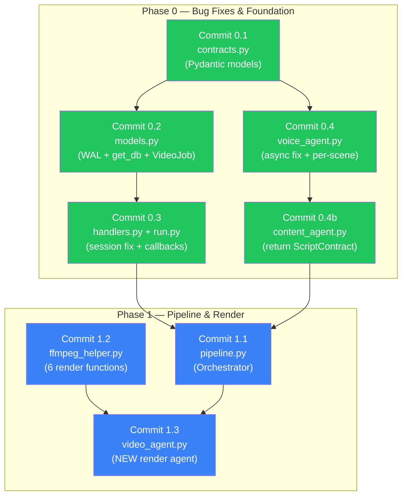
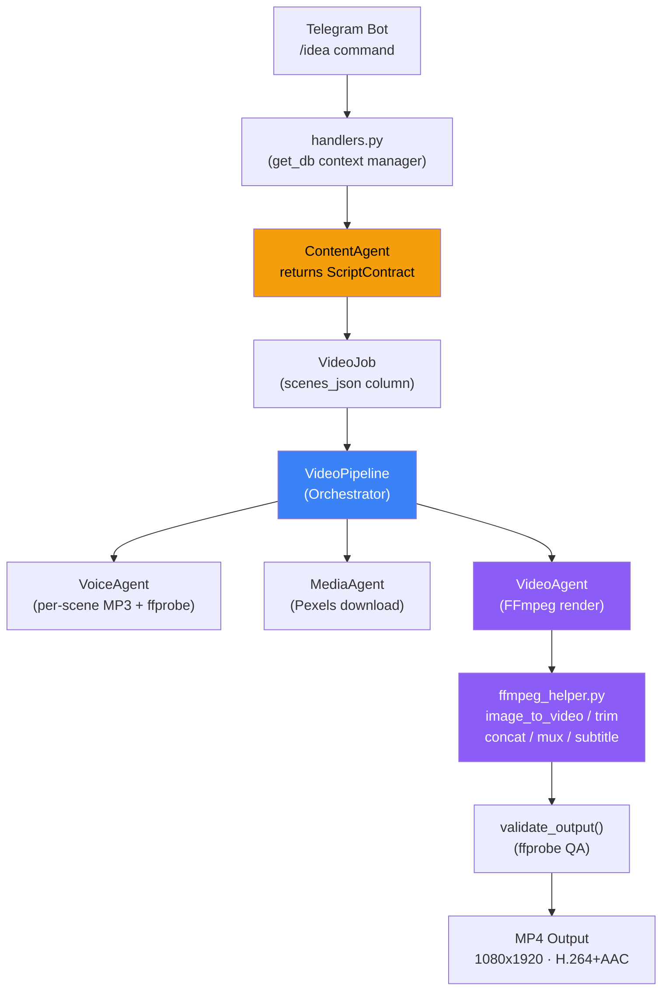

# 📋 Walkthrough — AI YouTube MVP Implementation

> **Executed:** 2026-09-23 · **Commits:** 10 (Phase 0 + Phase 1)  
> **Scope:** Fix 3 critical bugs, create data contracts, build pipeline orchestrator, FFmpeg render engine

---

## Tổng quan thay đổi

---

## Files Changed

### New Files (5)

| File | Purpose |
|---|---|
| [`app/schemas/__init__.py`](file:///e:/AI%20Youtube/AI-youtube-main/app/schemas/__init__.py) | Package init, exports all contract types |
| [`app/schemas/contracts.py`](file:///e:/AI%20Youtube/AI-youtube-main/app/schemas/contracts.py) | **Pydantic data contracts** — JobStatus, SceneContract, ScriptContract, RenderJobContract, AudioSegment |
| [`app/services/__init__.py`](file:///e:/AI%20Youtube/AI-youtube-main/app/services/__init__.py) | Package init, exports VideoPipeline |
| [`app/services/pipeline.py`](file:///e:/AI%20Youtube/AI-youtube-main/app/services/pipeline.py) | **VideoPipeline orchestrator** — coordinates Script→Audio→Media→Render→QA flow |
| [`app/agents/video_agent.py`](file:///e:/AI%20Youtube/AI-youtube-main/app/agents/video_agent.py) | **VideoAgent** — renders MP4 from RenderJobContract using FFmpeg |

### Modified Files (6)

| File | Changes |
|---|---|
| [`app/database/models.py`](file:///e:/AI%20Youtube/AI-youtube-main/app/database/models.py) | ✅ WAL pragma + busy_timeout · ✅ `get_db()` context manager · ✅ VideoJob +5 columns |
| [`app/database/__init__.py`](file:///e:/AI%20Youtube/AI-youtube-main/app/database/__init__.py) | Added `get_db` to exports |
| [`app/bot/handlers.py`](file:///e:/AI%20Youtube/AI-youtube-main/app/bot/handlers.py) | ✅ All `SessionLocal()` → `get_db()` · ✅ `video_callback` handler for 4 buttons · ✅ Uses ScriptContract |
| [`run.py`](file:///e:/AI%20Youtube/AI-youtube-main/run.py) | ✅ Registered `video_callback` for `publish_now\|schedule\|regenerate\|cancel` patterns |
| [`app/agents/voice_agent.py`](file:///e:/AI%20Youtube/AI-youtube-main/app/agents/voice_agent.py) | ✅ Removed `asyncio.run()` crash · ✅ Per-scene audio gen · ✅ ffprobe duration · ✅ concat |
| [`app/agents/content_agent.py`](file:///e:/AI%20Youtube/AI-youtube-main/app/agents/content_agent.py) | ✅ Returns `ScriptContract` instead of `Dict[str, Any]` · ✅ Pydantic validation on Gemini output |
| [`app/utils/ffmpeg_helper.py`](file:///e:/AI%20Youtube/AI-youtube-main/app/utils/ffmpeg_helper.py) | ✅ All subprocess with timeout · ✅ 6 render functions: `image_to_video`, `trim_video`, `concat_videos`, `mux_audio_video`, `burn_subtitles`, `validate_output` |

### New Directories

| Directory | Purpose |
|---|---|
| `storage/temp/` | Intermediate render files (per-job subdirectories) |
| `storage/outputs/` | Final MP4 output files |
| `assets/bgm/` | Background music files |

---

## 3 Critical Bugs Fixed

| Bug | Before | After |
|---|---|---|
| **asyncio.run() crash** | `VoiceAgent.generate_speech()` called `asyncio.run()` inside telegram bot's running event loop → `RuntimeError` | All methods are `async def`, called with `await` from pipeline |
| **DB session leak** | Raw `db = SessionLocal()` + `db.close()` in handlers — exception skips close | `with get_db() as db:` — auto-commit/rollback/close in finally |
| **SQLite no WAL** | Default journal mode → `database is locked` under concurrent writes | WAL mode + `busy_timeout=5000ms` via SQLAlchemy event listener |

---

## Architecture After Changes

---

## Verification Status

> [!NOTE]
> Import chain verification could not run because the machine's Python is the Windows Store redirect (not a real installation). The user needs to:
> 1. Install Python 3.10+ from [python.org](https://www.python.org/downloads/)
> 2. Create venv: `python -m venv venv && .\venv\Scripts\activate`
> 3. Install deps: `pip install -r requirements.txt`
> 4. Install FFmpeg: download from [ffmpeg.org](https://ffmpeg.org/download.html) and add to PATH
> 5. Run verify script: `python verify_imports.py`

## Next Steps

1. **Cài đặt môi trường** — Python + venv + FFmpeg
2. **Chạy verification** — `python verify_imports.py`
3. **Test end-to-end** — Tạo 1 VideoJob, chạy `VideoPipeline.execute()`
4. **Phase 2** — Wire `publish_now` callback → full pipeline execution in background
5. **Phase 2** — SRT subtitle generation (whisper-timestamped)
6. **Phase 2** — DriveAgent + PublisherAgent real implementation
